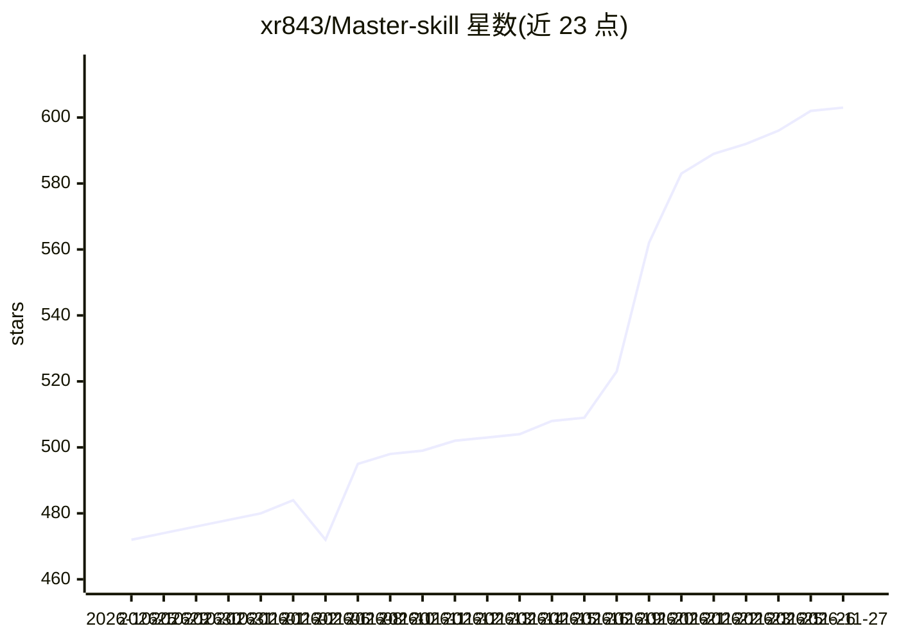

# xr843/Master-skill

⭐ 603 · Python · NOASSERTION · 推送 2026-11-26 · [GitHub](https://github.com/xr843/Master-skill) · [官网](https://fojin.ai) · 个人维护 · 中文 README

**面向佛学学习者与研究者的 AI 祖师人格对话框架**

以 16 位印度/汉传/藏传/南传祖师为persona的 AI 对话框架，通过 AgentSkills 交付到 Claude Code、Cursor、Codex CLI、OpenCode 与 Gemini CLI；普通读者可直接用 fojin.app/chat 网页版。核心机制包括：教义断言强制附 CBETA/BDRC/Toh/SuttaCentral/PTS 出处、HARD-GATE 禁止捏造来源、240 条夹具的保真度测试与离线引文审计、危机话题转介边界。README 明确 v1.0 门禁尚未达标（r7 教理 87.9%，门槛 90%）。另提供引文溯源与出处解析两个通用 skill 及 MCP 接入。

## 筛选速览

| 维度 | 判定 | 备注 |
|---|---|---|
| AI 角色 | `ai-native` | 本体是模型或模型工具 |
| 许可风险 | `permissive` | NOASSERTION |
| 部署形态 | `library` | 以包/库形式分发 |
| 模型依赖 | — | README 未给出锁定关系 |
| 硬件要求 | — | 无带数字的原话,不猜 |
| 安装摩擦 | `low` | 无编译、无系统依赖或容器化 |
| 成熟度 | — | 结构信号不足 |

## 能力要点

- 16 位四大传统祖师人格 + 4 个教学模式（对比/辩论/学修路径/选人）
- 所有教义断言强制附原典出处（CBETA/BDRC/Toh/SuttaCentral/PTS）
- 240 条保真度夹具 + 离线引文审计，README 公开各轮评测数据与失败分析
- 接入 FoJin 10K+ 篇文本、678K+ 条语义向量做实时经证检索

## 适用场景

- 直接在网页或终端里向某位祖师风格的角色提问佛学问题
- 佛学研究中核验一句话是否真的出自佛经、解析经号出处
- 为 Claude Code / Cursor 等工具安装佛教问答技能
- 跨传统比较不同祖师对同一问题的回答

## 场景标签

`聊天机器人` `RAG` `模型评测` · 领域:对话与助手

## 证据(README 行号)

> L20:  FoJin 驱动的佛教 AI 祖师人格框架
> L82: Master-skill 是由 FoJin 驱动的佛教 AI 祖师人格框架：以真实原典为来源，以伦理边界为约束，以保真度评测为质量门槛，并以 AgentSkills 运行协议交付给 Claude Code、Cursor、Codex
> L93: - **经文溯源（Provenance）**：每位祖师附声明来源 ID（CBETA / BDRC / Toh / SuttaCentral / PTS / 合规编纂开示）；实时检索仅在返回真实 `text_id` 时附 FoJin

## 星数曲线

2026-10-25 472 → 2026-11-27 603（+131）

---
*卡片 v1 · prompt 1.4 · 生成 2026-11-26 · 置信度 high · 依据 README sha `6496eccd46d3` · [字段定义](../../DATASET.md)*
