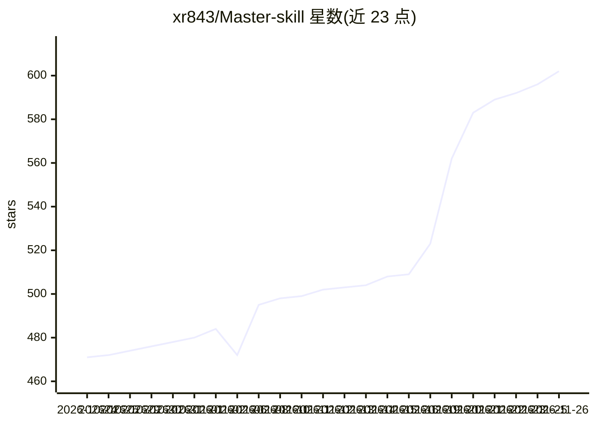

# xr843/Master-skill

⭐ 602 · Python · NOASSERTION · 推送 2026-11-25 · [GitHub](https://github.com/xr843/Master-skill) · [官网](https://fojin.ai) · 个人维护 · 中文 README

**面向佛学学习者和研究者的多祖师 AI 对话人格框架**

以 FoJin 经文数据为来源的佛教 AI 祖师人格框架，预置 16 位印度/汉传/藏传/南传祖师，每个回答强制附 CBETA/BDRC/SuttaCentral 等原典出处。内置 HARD-GATE 边界规则、240 条夹具的保真度测试与离线引文审计；普通用户可直接用 fojin.app/chat 网页版（15 位祖师），开发者可经 npx 安装 AgentSkill 到 Claude Code、Cursor、Codex CLI、OpenCode、Gemini CLI 五个终端。附 Rust 桌面评测管理器（需克隆仓库+Python）。

## 筛选速览

| 维度 | 判定 | 备注 |
|---|---|---|
| AI 角色 | `ai-native` | 本体是模型或模型工具 |
| 许可风险 | `permissive` | NOASSERTION |
| 部署形态 | `library` | 以包/库形式分发 |
| 模型依赖 | — | README 未给出锁定关系 |
| 硬件要求 | — | 无带数字的原话,不猜 |
| 安装摩擦 | `low` | 无编译、无系统依赖或容器化 |
| 成熟度 | — | 结构信号不足 |

## 能力要点

- 16 位祖师覆盖四大传统，附声明来源 ID（CBETA/BDRC/Toh/PTS/SuttaCentral）
- HARD-GATE 铁律禁止捏造来源 ID，教义断言强制附引证
- 240 条保真度测试夹具 + 离线引文审计，支持 Anthropic/DeepSeek/Gemini 作为评测 provider
- npx 一键安装到五个终端 Agent 平台，另含 4 个教学模式与 /create-master 生成器

## 适用场景

- 向特定祖师人格提问佛学问题并获得带经号出处的回答
- 跨传统对比不同祖师对同一问题的看法（/compare-masters）
- 学术写作中查找祖师原文的权威出处
- 佛学入门者按自身状况选择适合的法师与学修路径

## 场景标签

`模型评测` `RAG` `聊天机器人` · 领域:对话与助手

## 证据(README 行号)

> L82: Master-skill 是由 FoJin 驱动的佛教 AI 祖师人格框架：以真实原典为来源，以伦理边界为约束，以保真度评测为质量门槛，并以 AgentSkills 运行协议交付给 Claude Code、Cursor、Codex
> L92: - **预置十六位四大传统祖师**：1 位印度（龙树 · 中观）+ 9 位汉传（唯识、中观、禅、天台、华严、律、净土、跨宗派）+ 3 位藏传（阿底峡 · 噶当；宗喀巴 · 格鲁；米拉日巴 · 噶举）+ 3 位南传（觉音 · 上座部
> L41: 在 AI 问答页面左下角点击「法师模式」，从 15 位四大传统祖师中选一位即可开始对话。

## 星数曲线

2026-10-24 471 → 2026-11-26 602（+131）

---
*卡片 v1 · prompt 1.4 · 生成 2026-11-25 · 置信度 high · 依据 README sha `139b5074419b` · [字段定义](../../DATASET.md)*
