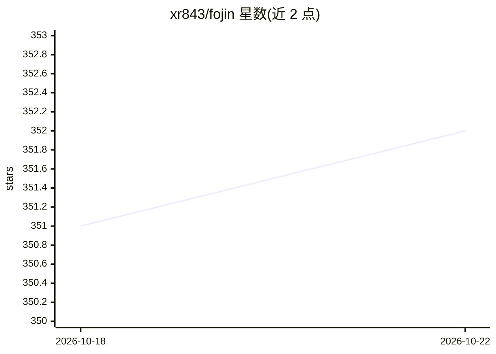

# xr843/fojin

⭐ 352 · Python · Apache-2.0 · 推送 2026-10-21 · [GitHub](https://github.com/xr843/fojin) · [官网](https://fojin.app) · 个人维护 · 中文 README

**面向佛学研究者与读者的佛教文献平台：带引文可验证的 AI 问答**

聚合 612 个数据源、10,500+ 文本（19,000+ 卷）的佛教数字文献平台，覆盖汉文/巴利/藏文/梵文。核心是 RAG 问答助手'XiaoJin'，在 670K+ 嵌入段落上检索，生成带可点击【《经》卷 N】引文的回答，含引用白名单、逐字核验与反幻觉机制。另提供三语跨藏经对读（LLM 校验的块级对齐）、110K+ 实体知识图谱、39 部辞典、全文检索与朗读，以及供 Claude/ChatGPT 等 MCP 客户端调用的 fojin-mcp 服务器与引文核验 API。通过 git clone + docker compose 自部署，文本数据需另行从原始来源导入，仓库不内置数据。

## 筛选速览

| 维度 | 判定 | 备注 |
|---|---|---|
| AI 角色 | `ai-native` | 本体是模型或模型工具 |
| 许可风险 | `permissive` | Apache-2.0 |
| 部署形态 | `self-host` | docker 或自建部署 |
| 模型依赖 | — | README 未给出锁定关系 |
| 硬件要求 | — | 无带数字的原话,不猜 |
| 安装摩擦 | `low` | 无编译、无系统依赖或容器化 |
| 成熟度 | — | 结构信号不足 |

## 能力要点

- RAG 问答带可点击引文与逐字引文核验（/api/verify/quote）
- CBETA×SuttaCentral×84000 三语跨藏经 LLM 校验块级对读
- 110K+ 实体知识图谱与 39 部辞典（747K 词条）
- fojin-mcp 服务器（8 个只读工具）供任意 MCP 客户端调用

## 适用场景

- 用自然语言提问佛经问题并获得可溯源引文回答
- 对照阅读汉/巴利/藏文跨藏经平行段落
- 从 Claude/ChatGPT 等 AI 助手中直接检索佛经典籍与核验引文

## 场景标签

 · 领域:数字人文/宗教文献

## 证据(README 行号)

> L7: Ask a question in plain language and FoJin's assistant **"XiaoJin"** answers from the canon itself — Retrieval-Augme
> L31: |**Ask a question, get a sourced answer**|**AI Q&A ("XiaoJin")** — RAG over 670K+ passages, reranking, root-sutra r

## 星数曲线

2026-10-18 351 → 2026-10-22 352（+1）

---
*卡片 v1 · prompt 1.4 · 生成 2026-10-21 · 置信度 mid · 依据 README sha `fd695e92bcff` · [字段定义](../../DATASET.md)*
