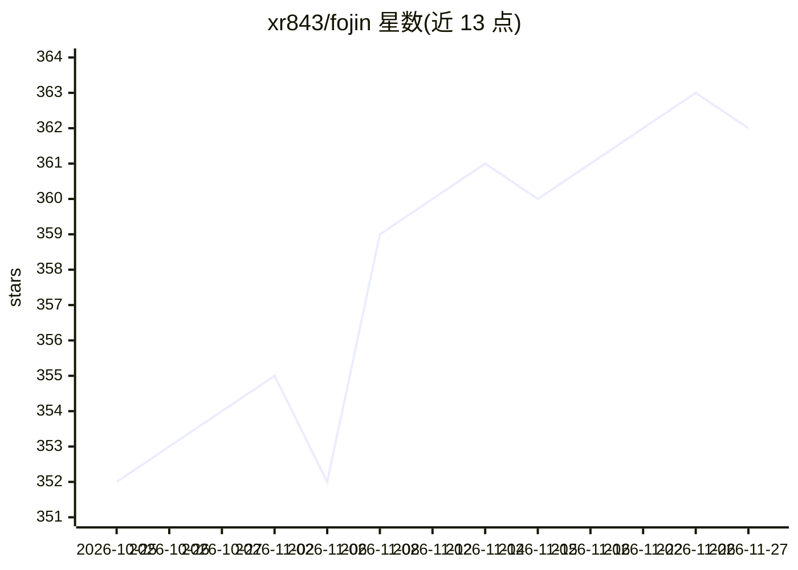

# xr843/fojin

⭐ 362 · Python · Apache-2.0 · 推送 2026-11-26 · [GitHub](https://github.com/xr843/fojin) · [官网](https://fojin.app) · 个人维护 · 中文 README

**面向佛学研究者与信众的佛典数字平台：RAG 问答带引文核验**

聚合 660+ 数据源、11,600+ 部佛典（汉/巴利/藏/梵）的平台，核心功能是以 XiaoJin 助手做基于 66 万+ 嵌入片段的检索增强问答，答案附可点击的《经》卷 N 引文，并有引文白名单与逐字降级等防幻觉机制。另提供三语跨藏对读、知识图谱、全文检索、39 部词典、语录核验 API，以及 fojin-mcp 服务器供 Claude/ChatGPT 等 MCP 客户端调用其语料。部署经 docker compose，文本数据需启动后自行导入，仓库不含语料。

## 筛选速览

| 维度 | 判定 | 备注 |
|---|---|---|
| AI 角色 | `ai-native` | 本体是模型或模型工具 |
| 许可风险 | `permissive` | Apache-2.0 |
| 部署形态 | `self-host` | docker 或自建部署 |
| 模型依赖 | — | README 未给出锁定关系 |
| 硬件要求 | — | 无带数字的原话,不猜 |
| 安装摩擦 | `low` | 无编译、无系统依赖或容器化 |
| 成熟度 | — | 结构信号不足 |

## 能力要点

- RAG 问答（XiaoJin）：66 万+ 嵌入片段、重排序与根经召回、可点击引文
- 语录核验：/api/verify/quote 对任意句子判真伪并给字符级 diff
- 汉/巴利/藏三语跨藏平行对读，4000+ LLM 校验的片段对齐
- fojin-mcp 服务器（mcp.fojin.ai）提供 9 个只读工具供 MCP 客户端调用

## 适用场景

- 用自然语言提问并获得可回溯到原典的佛学答案
- 粘贴一段文章或“佛说”语录，逐句核对是否出自汉译藏经
- 在同一界面并行比对汉/巴利/藏文本
- 让 Claude 等 AI 助手通过 MCP 从 FoJin 语料回答佛学问题

## 场景标签

`RAG` `语义搜索` `知识图谱` · 领域:知识与检索

## 证据(README 行号)

> L5: **AI Q&A grounded in the world's largest open aggregation of Buddhist texts: 600+ sources, 30+ languages, trilingual
> L7: Ask a question in plain language and FoJin's assistant **"XiaoJin"** answers from the canon itself — Retrieval-Augme
> L11: FoJin is built to be **open, cross-canon, verifiable Buddhist knowledge infrastructure** — not just a site to read,

## 星数曲线

2026-10-25 352 → 2026-11-27 362（+10）

---
*卡片 v1 · prompt 1.4 · 生成 2026-11-26 · 置信度 high · 依据 README sha `adc67cad89ab` · [字段定义](../../DATASET.md)*
