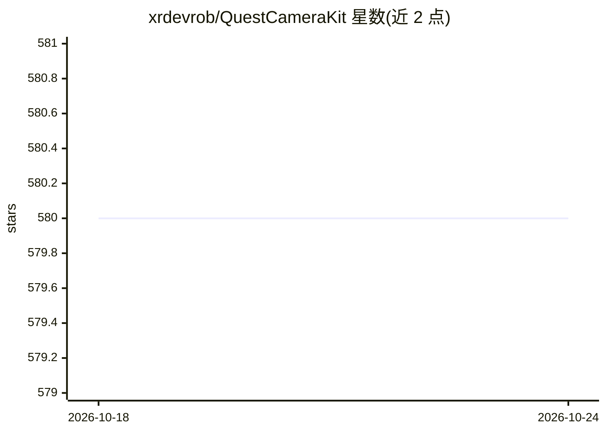

# xrdevrob/QuestCameraKit

⭐ 580 · C# · MIT · 推送 2026-09-23 · [GitHub](https://github.com/xrdevrob/QuestCameraKit) · [官网](https://bento.me/xrdevrob) · 个人维护

**Meta Quest 摄像头 API 的 Unity 示例集：取色/检测/QR/着色器/语音问答/串流**

面向 Unity 开发者的 Quest 3/3S Passthrough Camera API 模板与参考工程合集，含六个头显示例：环境取色、YOLO 物体检测（Unity Inference Engine 推理并将检测框投影到 3D 空间）、Meta MRUK 原生 QR 跟踪、立体相机着色器（磨砂玻璃/传送门）、录音转写后连 OpenAI 的图像语音问答，以及 WebRTC 视频串流。需 Unity 6000.3.12f1 与 Android 构建支持，编辑器内无法预览相机行为，须真机构建；维护记录显示设备端验收尚未完成。

## 筛选速览

| 维度 | 判定 | 备注 |
|---|---|---|
| AI 角色 | `ai-native` | 本体是模型或模型工具 |
| 许可风险 | `permissive` | MIT |
| 部署形态 | `None` |  |
| 模型依赖 | — | README 未给出锁定关系 |
| 硬件要求 | — | 无带数字的原话,不猜 |
| 安装摩擦 | `medium` | 含编译或系统依赖之一 |
| 成熟度 | — | 结构信号不足 |

## 能力要点

- 内置 YOLO 模型经 Unity Inference Engine 运行物体检测并投影到房间空间
- Meta MRUK 原生 QR 跟踪，解码 payload 并显示空间边界
- ImageLLM 示例：录音转写+相机帧发送 OpenAI 并播回答案
- Unity WebRTC 将头显相机视频串流到接收端

## 适用场景

- 学习如何在 Quest 应用中接入 Passthrough Camera API
- 在混合现实场景中做物体检测与 QR 码空间定位
- 开发语音问答式视觉助手或相机画面远程串流

## 场景标签

`目标检测` `语音识别` `多模态` · 领域:感知与多模态

## 证据(README 行号)

> L5: Unity samples for Meta Quest 3 and Quest 3S: sample real-world colors, detect objects, track QR codes, create camera
> L52: |Object detection|Run inference and place detection markers in 3D|`ObjectDetection`|
> L55: |Image + voice AI|Ask a spoken question about a camera image|`ImageLLM`|
> L68: Run the bundled YOLO model with Unity Inference Engine and project its detections into the room. Detection runs aut

## 星数曲线

2026-10-18 580 → 2026-10-24 580（+0）

---
*卡片 v1 · prompt 1.4 · 生成 2026-10-21 · 置信度 high · 依据 README sha `922ddd8cd6b3` · [字段定义](../../DATASET.md)*
