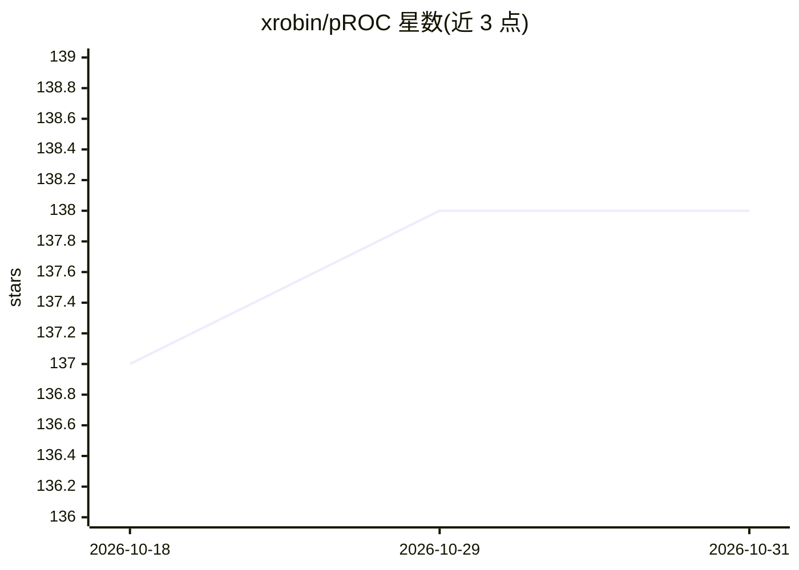

# xrobin/pROC

⭐ 138 · R · GPL-3.0 · 推送 2026-10-30 · [GitHub](https://github.com/xrobin/pROC) · [官网](https://xrobin.github.io/pROC/) · 个人维护

**R 语言 ROC 曲线分析与可视化统计包**

pROC 是一个 R 包，用于展示和分析 ROC 曲线：计算 AUC 与置信区间、曲线平滑、提取阈值坐标、对两条 ROC 曲线做统计检验（roc.test），并提供样本量/功效计算（power.roc.test）。面向生物医学与统计学研究者，配套数据集 aSAH 可直接上手。安装通过 CRAN 的 install.packages 或 devtools 从 GitHub 源码构建；开发版文档提供 vignette 构建与测试流程。方法学发表于 BMC Bioinformatics 论文（2011）。

## 筛选速览

| 维度 | 判定 | 备注 |
|---|---|---|
| AI 角色 | `ai-native` | 本体是模型或模型工具 |
| 许可风险 | `viral` | GPL-3.0 |
| 部署形态 | `None` |  |
| 模型依赖 | — | README 未给出锁定关系 |
| 硬件要求 | — | 无带数字的原话,不猜 |
| 安装摩擦 | `low` | 无编译、无系统依赖或容器化 |
| 成熟度 | — | 结构信号不足 |

## 能力要点

- ROC 曲线计算、平滑与 AUC 置信区间
- 两条 ROC 曲线的统计比较检验（roc.test）
- 样本量与功效计算（power.roc.test）
- coords 提取最优阈值及灵敏度/特异度等指标

## 适用场景

- 评估二分类诊断或预测模型的判别能力
- 比较两个模型的 ROC 曲线是否有显著差异
- 为诊断试验研究做样本量估计

## 场景标签

`模型评测` · 领域:评测与运维

## 证据(README 行号)

> L9: An R package to display and analyze ROC curves.
> L13: 1. Xavier Robin, Natacha Turck, Alexandre Hainard, *et al.* (2011) “pROC: an open-source package for R and S+ to an

## 星数曲线

2026-10-18 137 → 2026-10-31 138（+1）

---
*卡片 v1 · prompt 1.4 · 生成 2026-10-22 · 置信度 high · 依据 README sha `7c1973e0660e` · [字段定义](../../DATASET.md)*
