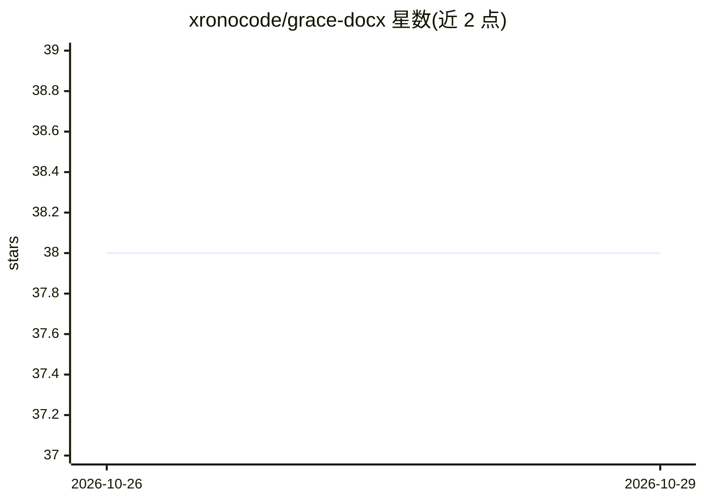

# xronocode/grace-docx

⭐ 38 · MIT · 推送 2026-10-25 · [GitHub](https://github.com/xronocode/grace-docx) · 个人维护

**让 AI agent 安全编辑 Office 文档的引导提示协议**

以 Markdown 引导提示（bootstrap prompt）形式提供的方法论仓库：用户把 grace-docx-bootstrap.md 与 .docx 一起交给 AI agent（Claude/ChatGPT/Codex 等），agent 解包文件、分析 Word XML、注入 5 个 grace-*.xml 元数据文件与不可见书签，使文档自描述，后续编辑按 manifest→graph→contracts→verification 协议执行，降低误改结构的风险。DOCX 为稳定 v3，PPTX 为预览 v1 附加格式。使用方式仅限下载提示文件配合 agent，无独立软件安装。

## 筛选速览

| 维度 | 判定 | 备注 |
|---|---|---|
| AI 角色 | `ai-ecosystem` | LLM/agent 周边工具 |
| 许可风险 | `permissive` | MIT |
| 部署形态 | `None` |  |
| 模型依赖 | — | README 未给出锁定关系 |
| 硬件要求 | — | 无带数字的原话,不猜 |
| 安装摩擦 | `low` | 无编译、无系统依赖或容器化 |
| 成熟度 | `idea` | |

## 能力要点

- 向 docx 包注入 5 个 XML 元数据文件与 H1 书签实现自描述
- v3 对表格/图表/SmartArt 等元素按类型建立可编辑性契约
- 编辑后运行 grace-verification.xml 结构校验
- PPTX 预览版将同一协议扩展到幻灯片与形状

## 适用场景

- 让 AI agent 在长 Word 文档中准确定位并安全编辑目标章节
- 防止 agent 误改表格结构、把图表图片当活图表编辑
- 为 PowerPoint 幻灯片建立可导航的形状清单与编辑契约

## 场景标签

`提示工程` · 领域:Agent 开发

## 证据(README 行号)

> L57: Attach the right bootstrap prompt and an Office document to a capable AI agent:
> L73: For Word, the agent unpacks the `.docx`, analyzes Word XML, injects GRACE metadata, adds invisible bookmarks around
> L127: 2. Open Claude, ChatGPT, Codex, or another agent that can inspect and edit OpenXML internals.

## 星数曲线

2026-10-26 38 → 2026-10-29 38（+0）

---
*卡片 v1 · prompt 1.4 · 生成 2026-10-25 · 置信度 high · 依据 README sha `4bf9774e8b2f` · [字段定义](../../DATASET.md)*
