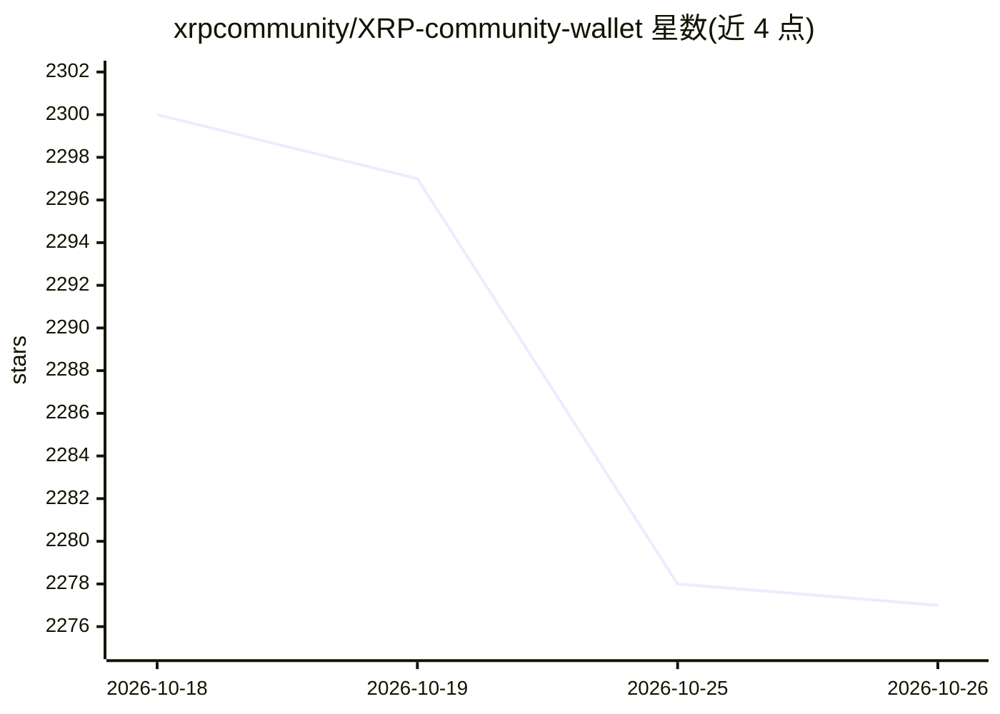

# xrpcommunity/XRP-community-wallet

⭐ 2,277 · TypeScript · MIT · 推送 2026-07-09 · [GitHub](https://github.com/xrpcommunity/XRP-community-wallet) · [官网](https://wallet.xrp.community)

**社区构建的 XRP 与 EVM 非托管网页钱包**

面向 XRP Ledger 及 EVM 兼容网络（Ethereum、BNB Smart Chain、Polygon）用户的非托管网页钱包：私钥与助记词以加密形式存储在浏览器本地 IndexedDB，由用户密码解锁，无服务器托管资金。功能覆盖钱包创建/导入（BIP39/BIP32）、Ledger 硬件钱包（WebHID）、转账收发、多链资产组合与交易历史、社区质押，支持 11 种语言与响应式界面。技术栈为 React 18 + TypeScript + Vite，属于 Ripple Community monorepo 的子应用，本地开发需 Node.js >= 20 与 pnpm >= 9，并依赖 @rc/* 工作区共享包。README 未展示 AI 相关功能，仅仓库主题标签含 ai-agent。

## 筛选速览

| 维度 | 判定 | 备注 |
|---|---|---|
| AI 角色 | `ai-enhanced` | 去掉 AI 部分产品仍成立 |
| 许可风险 | `permissive` | MIT |
| 部署形态 | `library` | 以包/库形式分发 |
| 模型依赖 | — | README 未给出锁定关系 |
| 硬件要求 | — | 无带数字的原话,不猜 |
| 安装摩擦 | `low` | 无编译、无系统依赖或容器化 |
| 成熟度 | — | 结构信号不足 |

## 能力要点

- 非托管：密钥与助记词仅加密存储于本地浏览器（IndexedDB）
- 单一界面支持 XRP Ledger 与 EVM 多链及自定义代币
- Ledger 硬件钱包支持（XRP，经 WebHID）
- 11 种语言（含 RTL 阿拉伯语）与响应式 UI

## 适用场景

- 在网页端自托管管理 XRP 与 EVM 链上资产
- 使用 Ledger 硬件钱包签名 XRP 交易
- 参与社区质押并查看多链聚合余额

## 场景标签

 · 领域:加密货币/区块链钱包

## 证据(README 行号)

> L13: Ripple Community Wallet is a non-custodial wallet for the XRP ecosystem and
> L29: - **Multi-chain.** XRP Ledger and EVM networks in a single interface: native

## 星数曲线

2026-10-18 2,300 → 2026-10-26 2,277（-23）

---
*卡片 v1 · prompt 1.4 · 生成 2026-10-21 · 置信度 low · 依据 README sha `190bce2fb9eb` · [字段定义](../../DATASET.md)*
