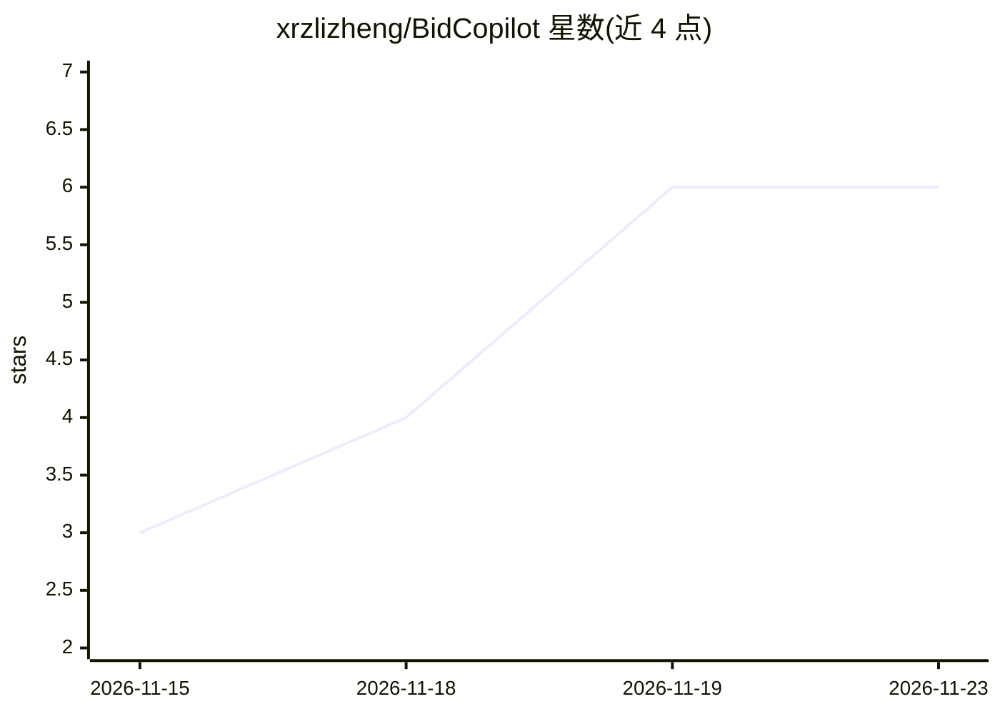

# xrzlizheng/BidCopilot

⭐ 6 · Python · NOASSERTION · 推送 2026-11-21 · [GitHub](https://github.com/xrzlizheng/BidCopilot) · [官网](https://bidcopilot-demo-byz953f82hk.qoder.zone/) · 组织维护 · 中文 README

**投标团队的 AI 辅助投标决策与交付平台**

自托管的投标全流程平台，覆盖商机同步与自动匹配、招标文件解析（docx/pdf/扫描件 OCR 双供应商）、章节生成、29 条合规预检、AI 评标模拟、合同审查与台账、报价策略计算、复盘分析等模块。FastAPI 单体加 Next.js 前端，单容器镜像支持单机、外置数据层、K8s 三种部署形态。社区版为 BSL 1.1 许可的单企业自部署，企业版闭源提供多租户与套餐计量。

## 筛选速览

| 维度 | 判定 | 备注 |
|---|---|---|
| AI 角色 | `ai-native` | 本体是模型或模型工具 |
| 许可风险 | `none` | NOASSERTION |
| 部署形态 | `self-host` | docker 或自建部署 |
| 模型依赖 | — | README 未给出锁定关系 |
| 硬件要求 | `gpu-8g` | |
| 安装摩擦 | `low` | 无编译、无系统依赖或容器化 |
| 成熟度 | — | 结构信号不足 |

## 能力要点

- 招标解析支持扫描件 OCR 双供应商（MinerU 本地 ONNX/minimax）
- 29 条确定性合规预检与跨章节标书查重
- 报价策略：历史价格带 P25/P50/P75 锚定三档建议价
- 单镜像三形态部署（单机/外置数据层/K8s Helm Chart）

## 适用场景

- IT 系统集成企业的投标部门管理商机到交付全流程
- 投标前对招标文件做合规体检与 Bid-No-Bid 决策
- 基于历史标书知识库生成标书并做事实核查
- 对合同条款做三方一致性对照与风险审查

## 场景标签

`文档解析` `AI 写作` `知识库管理` · 领域:内容生成

## 证据(README 行号)

> L3: 数据驱动的投标决策与交付平台。私有化优先，首版服务 IT/信息化/系统集成投标方。
> L38: |投标项目|招标解析（docx/pdf/txt/md + 扫描件 OCR 双供应商）、约束集、评分矩阵、Bid-No-Bid|✅|
> L39: |生成|章节生成、事实核查、审批、docx/暗标导出（暗标元数据自检+闸门拦截）|✅|

## 星数曲线

2026-11-15 3 → 2026-11-23 6（+3）

---
*卡片 v1 · prompt 1.4 · 生成 2026-11-20 · 置信度 mid · 依据 README sha `d335ea3075f4` · [字段定义](../../DATASET.md)*
