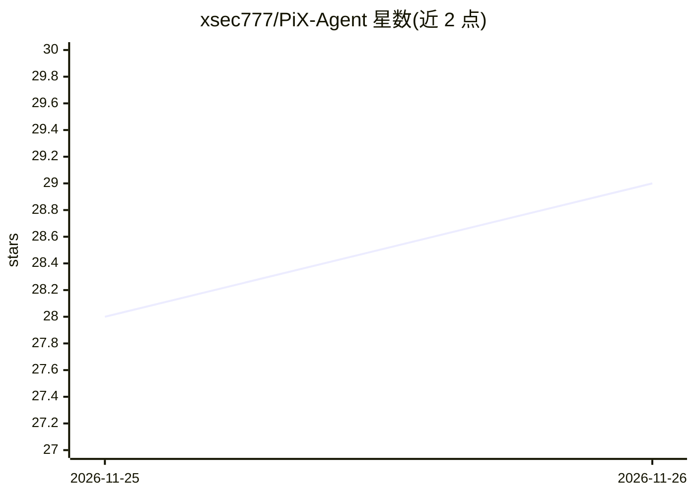

# xsec777/PiX-Agent

⭐ 29 · TypeScript · MIT · 推送 2026-11-25 · [GitHub](https://github.com/xsec777/PiX-Agent) · 个人维护 · 中文 README

**授权渗透测试 Agent 发行版：假设驱动推理+31个内置工具**

基于 pi-coding-agent 扩展机制二次开发的渗透测试 Agent 发行版，将渗透工程师推理方式固化为系统机制：事实/失败/假设/发现四段状态机画板、失败≥6次强制回读、失败率≥60%注入反思、节奏自适应。自带约2GB tools/ 目录内含31个实测渗透工具（nmap/sqlmap/nuclei/fscan 等38款CLI），toolbox 网关按需发现工具卡。支持 pent（SRC授权渗透）与 redt（红队演练）双模式，Windows 提供 cmd 启动脚本，仅面向已授权安全测试。

## 筛选速览

| 维度 | 判定 | 备注 |
|---|---|---|
| AI 角色 | `ai-native` | 本体是模型或模型工具 |
| 许可风险 | `permissive` | MIT |
| 部署形态 | `library` | 以包/库形式分发 |
| 模型依赖 | — | README 未给出锁定关系 |
| 硬件要求 | — | 无带数字的原话,不猜 |
| 安装摩擦 | `low` | 无编译、无系统依赖或容器化 |
| 成熟度 | `idea` | |

## 能力要点

- 三段状态机画板：能力/失败/假设/发现节点与 leads_to 攻击链边
- 内置38款纯CLI渗透工具随包分发，toolbox 网关按需 list/howto/search
- 双重护栏：读卡门禁+本机危险命令分级拦截+600s超时注入
- 画板跨会话持久化继承，/facts 导出 Ground Truth 事实底表

## 适用场景

- 在书面授权的 SRC 渗透测试中执行假设驱动的攻击链推理
- 红队演练中按任务书围栏开展内网横向与域攻坚
- 导出不可篡改的事实底表供自定义报告模板使用

## 场景标签

`网络安全` · 领域:学习与行业

## 证据(README 行号)

> L1: # 🛡️ PiX — 假设驱动、自带渗透工具箱的 Pi Agent 发行版
> L34: - 🧰 **自带工具箱**：31 个实测渗透工具 + 7 张扩展位卡，`toolbox` 网关按需发现（list / howto / search）
> L211: PiX 仅面向**已授权的安全测试**（自建靶场、书面授权 SRC、红队任务书范围）。pent 模式内置授权首条红线；redt 模式以任务书围栏。禁止用于未授权测试、DoS、数据牟利。使用者自行承担合规责任。

## 星数曲线

2026-11-25 28 → 2026-11-26 29（+1）

---
*卡片 v1 · prompt 1.4 · 生成 2026-11-25 · 置信度 mid · 依据 README sha `d39ee2574a98` · [字段定义](../../DATASET.md)*
