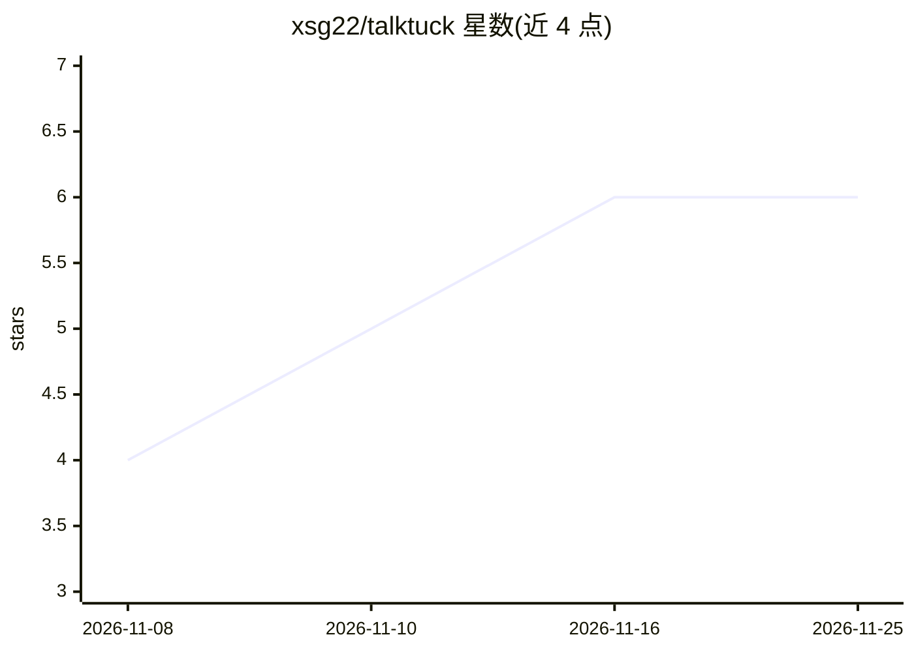

# xsg22/talktuck

⭐ 6 · Swift · 推送 2026-11-18 · [GitHub](https://github.com/xsg22/talktuck) · [官网](https://xueshengguo.com/apps/talktuck/) · 个人维护 · 中文 README

**macOS 本地录音与转录工具，支持 Agent/MCP 查询定稿**

TalkTuck 的 macOS 原生客户端源码：支持麦克风、系统声音或双路录音，mini 悬浮窗实时字幕，转录语言覆盖普通话、粤语、英语与中英自动，提供个人热词、按段回听、转录校正，导出 Markdown/文本/字幕，并用分组、搜索和星标管理录音；原音与文字保存在本机。通过 Skill、CLI 或 MCP 让本机 Agent 查询定稿。需 Apple Silicon、macOS 14+；当前发布为主功能验证版，本地签名、尚未 Apple 公证；Python 3.12 与语音引擎随包提供但模型需首次下载。

## 筛选速览

| 维度 | 判定 | 备注 |
|---|---|---|
| AI 角色 | `ai-native` | 本体是模型或模型工具 |
| 许可风险 | `none` | — |
| 部署形态 | `None` |  |
| 模型依赖 | — | README 未给出锁定关系 |
| 硬件要求 | — | 无带数字的原话,不猜 |
| 安装摩擦 | `low` | 无编译、无系统依赖或容器化 |
| 成熟度 | `idea` | |

## 能力要点

- 麦克风/系统声音双路录音，悬浮窗实时字幕
- 普通话、粤语、英语及中英自动转录，支持个人热词
- 通过 Skill、CLI 或 MCP 供本机 Agent 查询定稿
- 账号登录后自动同步录音、定稿与原音，可暂停同步

## 适用场景

- 会议或访谈的本地录音并转成文字
- 让本机 Agent 读取转录定稿并整理重点
- 导入已有音频进行转录、校正与导出字幕

## 场景标签

`语音识别` · 领域:感知与多模态

## 证据(README 行号)

> L17: - 麦克风、系统声音或两路一起录，录音中可分别控制音源。
> L23: - 通过 Skill、CLI 或 MCP，让本机 Agent 查询定稿并按需整理重点。

## 星数曲线

2026-11-08 4 → 2026-11-25 6（+2）

---
*卡片 v1 · prompt 1.4 · 生成 2026-11-20 · 置信度 mid · 依据 README sha `1c0e1b7a3ebd` · [字段定义](../../DATASET.md)*
