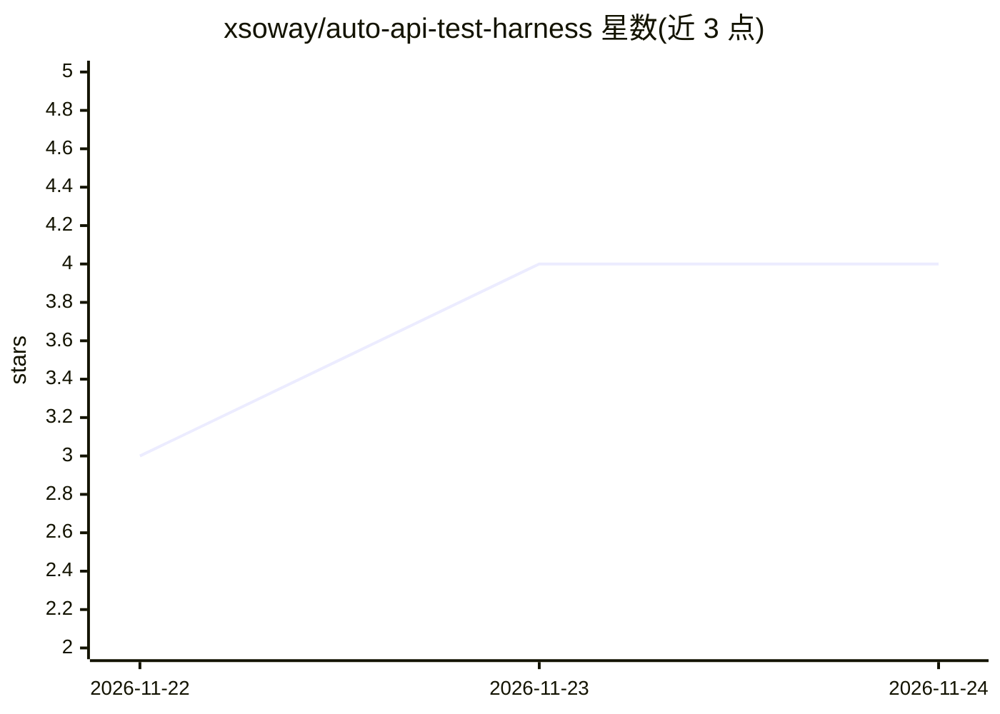

# xsoway/auto-api-test-harness

⭐ 4 · Python · MIT · 推送 2026-11-21 · [GitHub](https://github.com/xsoway/auto-api-test-harness) · [官网](https://xsoway.github.io/auto-api-test-harness/) · 个人维护 · 中文 README

**面向 Agent 的 API 测试与用例演化框架：契约转用例、失败转演化**

以 Python + pytest + YAML 实现的 API 测试与用例演化框架：从 OpenAPI/HAR 导入契约生成用例骨架，执行单接口与多步流程并输出含请求/响应/断言证据的 receipt 与 Markdown/JSON/HTML 报告；Agent Loop 从回归失败中生成候选、评分去重后写回 data/evolution.yaml，失败治理按规则与指纹路由缺陷/重跑/修复候选。提供 ah CLI 覆盖演化、治理、覆盖缺口、场景发现、趋势与脚手架等命令，含 pytest 插件与可选 SQLite 追踪及本地 dashboard。模型调用可选，LLMOFF=1 时全离线 mock 运行；需 Python 3.10+ 与 uv。

## 筛选速览

| 维度 | 判定 | 备注 |
|---|---|---|
| AI 角色 | `ai-enhanced` | 去掉 AI 部分产品仍成立 |
| 许可风险 | `permissive` | MIT |
| 部署形态 | `None` |  |
| 模型依赖 | — | README 未给出锁定关系 |
| 硬件要求 | — | 无带数字的原话,不猜 |
| 安装摩擦 | `low` | 无编译、无系统依赖或容器化 |
| 成熟度 | — | 结构信号不足 |

## 能力要点

- Agent Loop：失败→候选生成→评分去重→写回演化文件，支持 undo 回退
- 从 OpenAPI/HAR 导入契约并做覆盖缺口与跨接口依赖发现
- LLMOFF=1 全离线运行，模型仅参与规划/候选/诊断等增强步骤
- 28 项能力的 HTML 报告矩阵与 SQLite/本地 dashboard 可观测

## 适用场景

- 接口频繁变更时自动补齐和演化 API 回归用例
- 回归失败后定位根因并区分产品缺陷与脚本问题
- 基于 Git 变更挑选受影响接口做针对性回归
- 以 YAML 维护多步链路与严格失败阻断场景

## 场景标签

`代码生成` · 领域:编码与开发

## 证据(README 行号)

> L8:  An Agent-oriented API testing and testcase-evolution framework.
> L22: HTTP requests, variable passing and business assertions are executed by the Harness. Models can participate in **pl
> L237: - With `LLMOFF=1` the framework makes no model calls and runs safely offline; `--llm-off` is equivalent.

## 星数曲线

2026-11-22 3 → 2026-11-24 4（+1）

---
*卡片 v1 · prompt 1.4 · 生成 2026-11-22 · 置信度 high · 依据 README sha `9329ebe491f7` · [字段定义](../../DATASET.md)*
