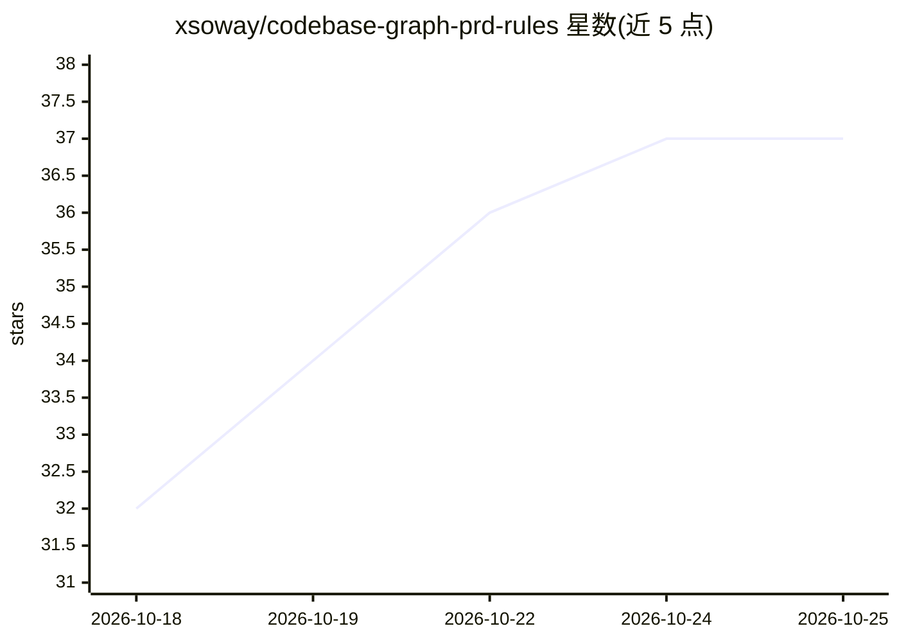

# xsoway/codebase-graph-prd-rules

⭐ 37 · HTML · MIT · 推送 2026-09-24 · [GitHub](https://github.com/xsoway/codebase-graph-prd-rules) · [官网](https://xsoway.github.io/codebase-graph-prd-rules/) · 个人维护 · 中文 README

**把代码库转成可溯源业务规则文档的两个 AI-agent 技能**

面向产品、运营与 QA 等非开发者的两个 AI-agent 技能包：先用 Graphify 构建代码图谱定位入口与调用链，再逐条对照源码、SQL/XML 与配置确认业务规则，输出含来源（src/…:line）、Mermaid 图与 P0/P1 测试矩阵的 Markdown 文档。`codebase-graph-business-rules` 覆盖全项目扫描，`codebase-graph-module-rules` 做单模块深挖。证据分级区分 EXTRACTED/INFERRED/已验证；仅分析不修改系统，LLM 凭据可选，缺失时回退到结构图+源码审阅。每个技能含 3 个 eval 用例与 Python 3.9+（仅标准库）校验脚本。

## 筛选速览

| 维度 | 判定 | 备注 |
|---|---|---|
| AI 角色 | `ai-ecosystem` | LLM/agent 周边工具 |
| 许可风险 | `permissive` | MIT |
| 部署形态 | `None` |  |
| 模型依赖 | — | README 未给出锁定关系 |
| 硬件要求 | — | 无带数字的原话,不猜 |
| 安装摩擦 | `low` | 无编译、无系统依赖或容器化 |
| 成熟度 | — | 结构信号不足 |

## 能力要点

- 每条规则携带 src/…:line 来源，可审计可追溯
- 证据分级：EXTRACTED / INFERRED / 源码验证分开报告
- 图谱仅用于导航，规则以源码确认为准
- 每技能附 3 个 eval 用例与包结构校验脚本

## 适用场景

- 为产品/运营/QA 输出可读的业务规则文档
- 为全项目建立 PRD 基线或模块级规则梳理
- 从关键规则生成可执行的 P0/P1 测试断言矩阵

## 场景标签

`代码审查` `Agent 框架` · 领域:Agent 开发

## 证据(README 行号)

> L18: `codebase-graph-prd-rules` is a set of two complementary AI-agent **skills** that turn project source code into det
> L20: Both skills share the same methodology and evidence boundary — build a **Graphify** code graph first, use it to loc

## 星数曲线

2026-10-18 32 → 2026-10-25 37（+5）

---
*卡片 v1 · prompt 1.4 · 生成 2026-10-25 · 置信度 high · 依据 README sha `04a13e319897` · [字段定义](../../DATASET.md)*
