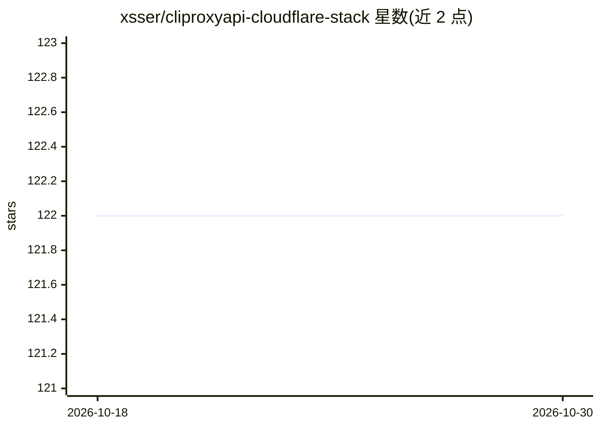

# xsser/cliproxyapi-cloudflare-stack

⭐ 122 · Shell · 推送 2026-07-12 · [GitHub](https://github.com/xsser/cliproxyapi-cloudflare-stack) · 个人维护 · 中文 README

**自托管 OpenAI 兼容 LLM API 网关部署栈（Cloudflare）**

用部署脚本在自有基础设施上搭建 OpenAI 兼容的 LLM API 网关：以 CLIProxyAPI 为核心，支持多凭证池、热加载与故障转移，对外暴露 /v1/*；配合 Cloudflare Worker + D1 在自有域名程序化收信，并用 Cloudflare Tunnel 将内网网关反代为 HTTPS 公网域名，无需公网 IP 与开放入站端口。面向不想把凭证交给第三方中转、需统一入口与多凭证管理的自托管用户。README 附免责声明：仅限管理已授权凭证，禁止自动注册或绕过验证。

## 筛选速览

| 维度 | 判定 | 备注 |
|---|---|---|
| AI 角色 | `ai-ecosystem` | LLM/agent 周边工具 |
| 许可风险 | `none` | — |
| 部署形态 | `None` |  |
| 模型依赖 | — | README 未给出锁定关系 |
| 硬件要求 | — | 无带数字的原话,不猜 |
| 安装摩擦 | `low` | 无编译、无系统依赖或容器化 |
| 成熟度 | — | 结构信号不足 |

## 能力要点

- CLIProxyAPI 多凭证池、热加载、故障转移
- Cloudflare Tunnel 反代内网网关为 HTTPS，无需公网入站端口
- Worker + D1 在自有域名程序化收信
- 脚本化部署（deploy_vm.sh / sync_credentials.sh / wrangler）

## 适用场景

- 用自有凭证统一对外提供 OpenAI 兼容 API 入口
- 内网网关不出公网 IP/不开端口地暴露 HTTPS
- 多凭证池管理与故障转移

## 场景标签

`模型网关` · 领域:Agent 开发

## 证据(README 行号)

> L3: 用自己的凭证搭一个 OpenAI 兼容的 LLM API 网关，全部跑在自托管基础设施上。
> L10: - **API 网关**：CLIProxyAPI 多凭证池、热加载、故障转移，对外暴露 `/v1/*`。

## 星数曲线

2026-10-18 122 → 2026-10-30 122（+0）

---
*卡片 v1 · prompt 1.4 · 生成 2026-10-23 · 置信度 high · 依据 README sha `f00fb4eee5a7` · [字段定义](../../DATASET.md)*
