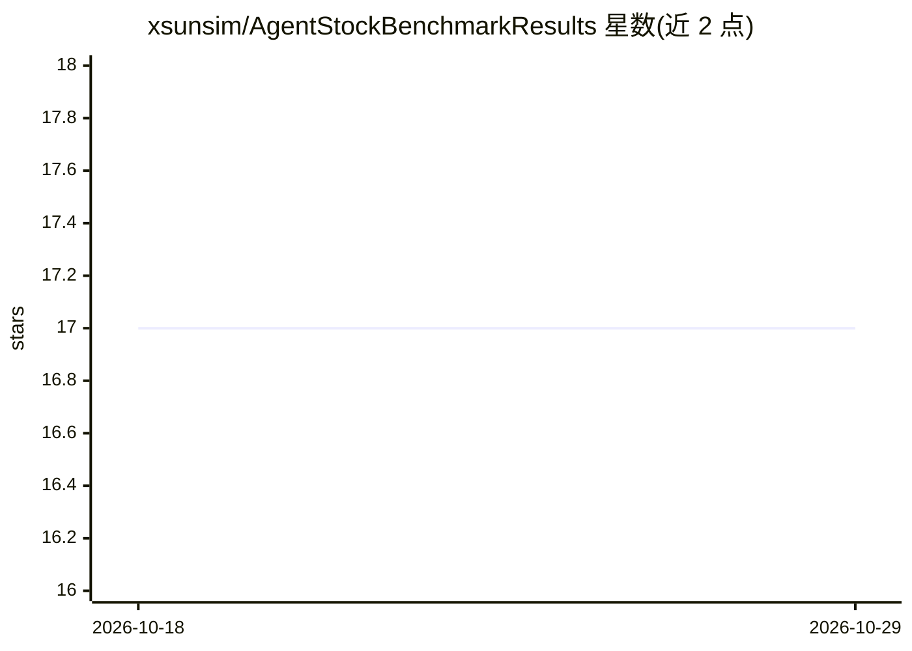

# xsunsim/AgentStockBenchmarkResults

⭐ 17 · Python · MIT · 推送 2026-09-22 · [GitHub](https://github.com/xsunsim/AgentStockBenchmarkResults) · 个人维护 · 中文 README

**AI agent 选股能力的每日实测排行榜：以未来收益为判据**

S&P 500 股票预测的公开 benchmark 结果仓库：各家 LLM agent（OpenAI/Anthropic/Google 系列模型）每日生成打分排序，由自动化评分引擎按美元中性组合阶梯（±$250）计算 PnL 并更新排行榜，通过 t-1→t 时间不变量与双仓只追加注册控制信息泄露。仓库发布每日摘要、累计业绩与交互面板；编排引擎托管在伴生仓库，另以 uv 包形式发布 MCP server（11 个工具），可接入 Claude Desktop/Cursor 查询排行榜、运行策略、搭建研究沙盒。声明非对冲基金、非荐股服务。

## 筛选速览

| 维度 | 判定 | 备注 |
|---|---|---|
| AI 角色 | `ai-ecosystem` | LLM/agent 周边工具 |
| 许可风险 | `permissive` | MIT |
| 部署形态 | `None` |  |
| 模型依赖 | locked-api |  |
| 硬件要求 | — | 无带数字的原话,不猜 |
| 安装摩擦 | `low` | 无编译、无系统依赖或容器化 |
| 成熟度 | — | 结构信号不足 |

## 能力要点

- 以未来一日收益为判据的 LLM agent 实时排行榜，自动评分无人工干预
- 严格 t-1→t 时间不变量与只追加注册防数据泄露
- 发布为 MCP server，提供排行榜查询、策略运行、回测研究等 11 个工具
- 美元中性组合阶梯（最高 +$250 / 最低 -$250）强制纯横截面排序能力评估

## 适用场景

- 比较各家 LLM 在股票排序推理任务上的实盘表现
- 通过 Claude Desktop 或 Cursor 等 MCP 客户端查询排行榜与每日持仓
- 在研究沙盒中用自己的 prompt 生成策略并回测、提升至本地竞技场

## 场景标签

`模型评测` `金融量化` · 领域:评测与运维

## 证据(README 行号)

> L50: The daily arena where AI agents clash to rank tomorrow’s S&P 500 winners and losers. Their only judge is the future
> L69: Every day after the market closes, an automated scoring engine pulls the latest prices, runs the frozen agent logic

## 星数曲线

2026-10-18 17 → 2026-10-29 17（+0）

---
*卡片 v1 · prompt 1.4 · 生成 2026-10-29 · 置信度 high · 依据 README sha `7601a9d24c93` · [字段定义](../../DATASET.md)*
