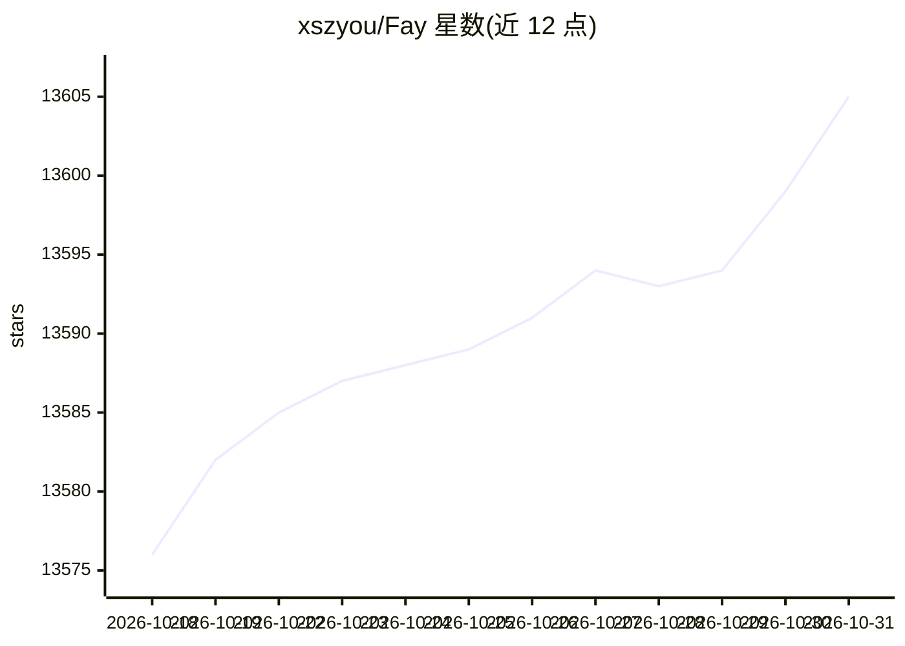

# xszyou/Fay

⭐ 13,605 · Python · GPL-3.0 · 推送 2026-09-21 · [GitHub](https://github.com/xszyou/Fay) · 个人维护 · 中文 README

**为数字人与大语言模型连通业务系统的 agent 框架**

Fay 数字人框架向上适配各类数字人模型技术（2.5d、3d、移动、pc、网页），向下接入 openai 兼容接口与 deepseek 等大语言模型，并可更换 TTS、ASR 模型，为单片机、app、网站等终端提供数字人应用接口。功能包含全时流式、多用户多路并发、自动播报模式（虚拟教师/主播/新闻播报）、自定义知识库与人设、唤醒打断对话、MCP 工具管理与 agent 自主决策工具调用、仿生记忆等。源码启动需 Python 3.12，支持 Windows/macOS/Ubuntu。

## 筛选速览

| 维度 | 判定 | 备注 |
|---|---|---|
| AI 角色 | `ai-native` | 本体是模型或模型工具 |
| 许可风险 | `viral` | GPL-3.0 |
| 部署形态 | `library` | 以包/库形式分发 |
| 模型依赖 | locked-api |  |
| 硬件要求 | — | 无带数字的原话,不猜 |
| 安装摩擦 | `medium` | 含编译或系统依赖之一 |
| 成熟度 | — | 结构信号不足 |

## 动量与使用信号

- 维护:`active` — 距上次 push 27.0 天,年发版 0,5 位贡献者
- 涨星:近 1 天 **-1**(自 20261016 起算)
- 平台:WINDOWS / MACOS · 协议:MCP

## 能力要点

- 支持任意终端接入：单片机、app、网站、大屏、三方业务系统
- 支持多用户多路并发与全时流式
- 提供文字/语音交互、数字人驱动、自动播报、意图等接口
- 支持 MCP 工具管理（sse、studio）与 agent 自主决策工具调用

## 适用场景

- 搭建虚拟主播、虚拟教师等自动播报数字人
- 为网页或 app 接入语音交互数字人
- 自定义知识库与人设搭建业务问答数字人

## 场景标签

`Agent 框架` · 领域:Agent 开发

## 证据(README 行号)

> L7: 我们致力于思考面向终端的数字人落地应用，并通过完整代码把思考结果呈现给大家。Fay数字人框架，向上适配各种数字人模型技术，向下接入各式大语言模型，并且便于更换诸如TTS、ASR等模型，为单片机、app、网站提供全面的数字人应用接口。
> L16: - 自由匹配数字人模型、大语言模型（openai 兼容接口）、ASR、TTS模型

## 星数曲线

2026-10-18 13,576 → 2026-10-31 13,605（+29）

---
*卡片 v1 · prompt 1.4 · 生成 2026-10-18 · 置信度 high · 依据 README sha `c7b39418b358` · [字段定义](../../DATASET.md)*
