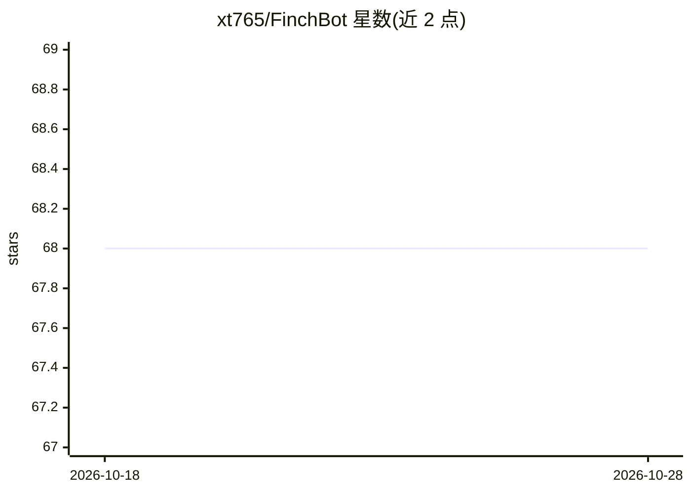

# xt765/FinchBot

⭐ 68 · Python · MIT · 推送 2026-10-15 · [GitHub](https://github.com/xt765/FinchBot) · 个人维护 · 中文 README

**面向开发者的自主 AI Agent 框架，支持自我扩展与任务自调度**

基于 LangChain v1.2 与 LangGraph v1.0 的 Python AI Agent 框架，采用全异步架构。核心机制包括：能力自扩展（19 个内置工具、Agent 通过 configure_mcp 动态配置 MCP 服务器、通过内置 skill-creator 自动创建技能）、任务自调度（后台任务、定时任务与心跳服务三层调度）、记忆自管理（Agentic RAG + 加权 RRF 混合检索）、行为自演化（动态修改提示词并热加载）。附路径限制、Shell 命令黑名单、工具注册校验等安全机制，网络搜索支持 Tavily/Brave/DuckDuckGo 三引擎回退。

## 筛选速览

| 维度 | 判定 | 备注 |
|---|---|---|
| AI 角色 | `ai-ecosystem` | LLM/agent 周边工具 |
| 许可风险 | `permissive` | MIT |
| 部署形态 | `None` |  |
| 模型依赖 | — | README 未给出锁定关系 |
| 硬件要求 | — | 无带数字的原话,不猜 |
| 安装摩擦 | `low` | 无编译、无系统依赖或容器化 |
| 成熟度 | — | 结构信号不足 |

## 能力要点

- 三层能力扩展：19 个内置工具 + MCP 自配置 + skill-creator 自动创建技能
- 三层任务调度：后台任务（四工具模式）、定时任务（at/every/cron）与心跳服务
- Agentic RAG + Weighted RRF 混合检索的持久记忆（自记忆/自检索/自遗忘）
- 安全机制：路径限制、Shell 命令黑名单、仅注册工具可执行

## 适用场景

- 搭建能自主配置工具和创建技能的 Agent 应用
- 让 Agent 在后台执行长任务并定时调度（如每日报告、定期监控）
- 构建带持久记忆与会话管理的对话式 Agent

## 场景标签

`Agent 框架` `RAG` `Agent 记忆` · 领域:Agent 开发

## 证据(README 行号)

> L34: **FinchBot** is an AI Agent framework that empowers agents with true autonomy, built on **LangChain v1.2** and **La
> L36: 1. **Capability Self-Extension** — Agent can use built-in tools to configure MCP and create skills when hitting cap

## 星数曲线

2026-10-18 68 → 2026-10-28 68（+0）

---
*卡片 v1 · prompt 1.4 · 生成 2026-10-24 · 置信度 high · 依据 README sha `030e9007f8fe` · [字段定义](../../DATASET.md)*
