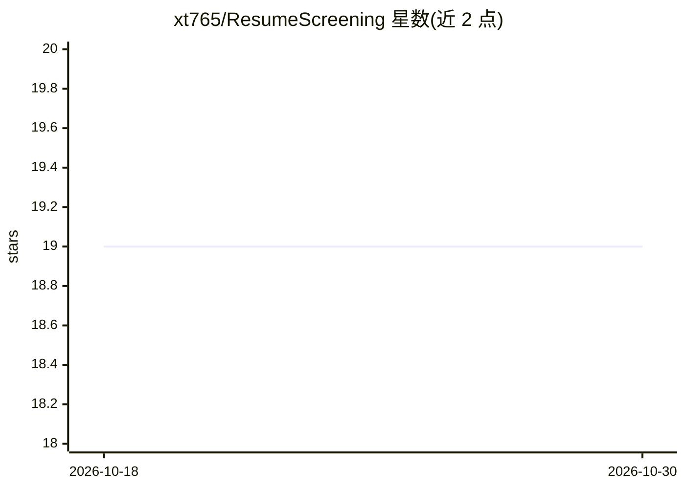

# xt765/ResumeScreening

⭐ 19 · Python · MIT · 推送 2026-03-13 · [GitHub](https://github.com/xt765/ResumeScreening) · 个人维护 · 中文 README

**面向 HR 的简历智能筛选系统，LLM 解析+筛选+RAG 问答**

基于 LangChain + LangGraph + FastAPI 构建的招聘简历处理系统，面向 HR 用户：批量上传 PDF/DOCX 简历后，经 LangGraph 状态机四节点工作流完成解析（DeepSeek 提取 20+ 字段、OpenCV 人脸检测）、条件筛选（自然语言条件描述）、存储（MySQL/MinIO/ChromaDB，AES 加密敏感字段）与缓存推送。智能问答采用 Agentic RAG 架构（Agent 决策 + 多工具协同），检索用向量 0.7 + BM25 0.3 的加权 RRF 融合。Docker Compose 一键部署，需配置 DeepSeek 与 DashScope API Key。

## 筛选速览

| 维度 | 判定 | 备注 |
|---|---|---|
| AI 角色 | `ai-native` | 本体是模型或模型工具 |
| 许可风险 | `permissive` | MIT |
| 部署形态 | `self-host` | docker 或自建部署 |
| 模型依赖 | locked-api |  |
| 硬件要求 | — | 无带数字的原话,不猜 |
| 安装摩擦 | `low` | 无编译、无系统依赖或容器化 |
| 成熟度 | — | 结构信号不足 |

## 能力要点

- LangGraph 状态机四节点工作流，支持断点续传与错误恢复
- DeepSeek LLM 提取简历 20+ 结构化字段，支持自然语言筛选条件
- Agentic RAG 智能问答，Agent 动态选择检索/统计/筛选工具
- 加权 RRF 混合检索（向量 0.7 + BM25 0.3）

## 适用场景

- HR 批量上传简历并按自然语言条件自动筛选
- 对简历库进行自然语言问答与统计分析
- 候选人敏感信息加密存储并按权限脱敏访问

## 场景标签

`文档解析` `知识库管理` · 领域:知识与检索

## 证据(README 行号)

> L62: - **智能解析**：自动提取姓名、学历、技能、工作经历等 20+ 字段，支持 PDF/DOCX 格式
> L128: - **AI 能力层**：DeepSeek LLM 提供智能解析，DashScope 提供向量化服务
> L252: ### Agentic RAG 智能问答

## 星数曲线

2026-10-18 19 → 2026-10-30 19（+0）

---
*卡片 v1 · prompt 1.4 · 生成 2026-10-28 · 置信度 mid · 依据 README sha `c4edb862225f` · [字段定义](../../DATASET.md)*
