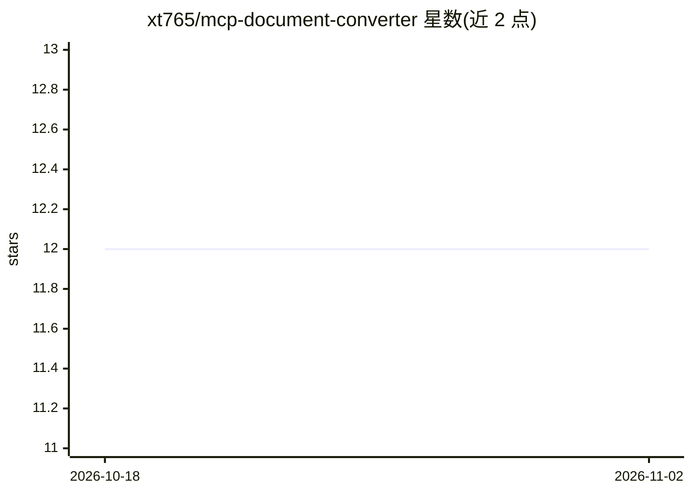

# xt765/mcp-document-converter

⭐ 12 · Python · MIT · 推送 2026-03-02 · [GitHub](https://github.com/xt765/mcp-document-converter) · 个人维护 · 中文 README

**给 AI agent 的 MCP 文档格式转换服务器：5 格式互转**

符合 MCP 协议的文档转换服务器，供 Trae IDE、Claude Desktop、Cherry Studio 等 AI 助手作为工具调用，也可作为 Python 库单独使用。支持 Markdown/HTML/DOCX/PDF/Text 五种格式双向转换（25 种组合），内部经 DocumentIR 中间表示，由解析器与渲染器经注册表自动匹配完成转换，并提供转换矩阵查询、元数据保留、自定义 CSS、代码语法高亮等选项；解析器与渲染器可注册扩展。PDF 输出基于 WeasyPrint 生成，支持分页。提供 pip 安装与源码安装两种方式。

## 筛选速览

| 维度 | 判定 | 备注 |
|---|---|---|
| AI 角色 | `ai-ecosystem` | LLM/agent 周边工具 |
| 许可风险 | `permissive` | MIT |
| 部署形态 | `library` | 以包/库形式分发 |
| 模型依赖 | — | README 未给出锁定关系 |
| 硬件要求 | — | 无带数字的原话,不猜 |
| 安装摩擦 | `low` | 无编译、无系统依赖或容器化 |
| 成熟度 | — | 结构信号不足 |

## 能力要点

- 5 种文档格式双向转换，经 DocumentIR 中间表示统一处理
- MCP 协议服务器，供 Trae IDE / Claude Desktop / Cherry Studio 等 AI 助手调用
- 转换矩阵查询、格式信息查询、元数据保留、自定义 CSS 模板
- 解析器/渲染器插件架构，可注册扩展新格式

## 适用场景

- 在 MCP 客户端（Claude Desktop、Trae IDE、Cherry Studio）中让 AI 助手完成文档格式转换
- 在 Python 程序中直接调用转换引擎处理 Markdown/HTML/DOCX/PDF/Text
- 为自有格式开发自定义解析器与渲染器扩展转换能力

## 场景标签

`文档解析` · 领域:知识与检索

## 证据(README 行号)

> L22: - **MCP Protocol**: Compliant with MCP standards, can be used as a tool for AI assistants like Trae IDE
> L174: After configuration, AI assistants can directly call the following tools:

## 星数曲线

2026-10-18 12 → 2026-11-02 12（+0）

---
*卡片 v1 · prompt 1.4 · 生成 2026-10-31 · 置信度 high · 依据 README sha `1d7cf1c337f5` · [字段定义](../../DATASET.md)*
