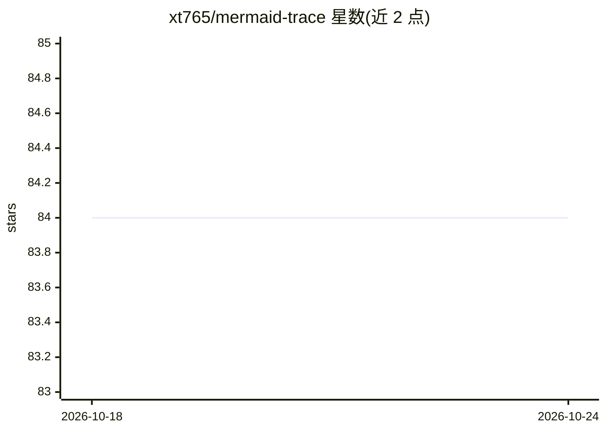

# xt765/mermaid-trace

⭐ 84 · Python · MIT · 推送 2026-03-06 · [GitHub](https://github.com/xt765/mermaid-trace) · 个人维护 · 中文 README

**将 Python 代码执行自动转为 Mermaid 时序图的日志可视化库**

通过装饰器（@trace/@trace_class）插桩 Python 代码，把函数调用、asyncio 协程与分布式调用链自动生成为 Mermaid 时序图，并附带带热重载与文件浏览的 CLI 预览服务器。面向需要理解遗留代码、生成技术文档、调试递归与并发的开发者。支持 W3C Trace Context/B3 分布式追踪、敏感字段数据脱敏、采样率配置、重复调用折叠，并提供 FastAPI 中间件与 LangChain Callback Handler 集成，可可视化 LLM 链、agent 与 RAG 检索流程。

## 筛选速览

| 维度 | 判定 | 备注 |
|---|---|---|
| AI 角色 | `ai-ecosystem` | LLM/agent 周边工具 |
| 许可风险 | `permissive` | MIT |
| 部署形态 | `library` | 以包/库形式分发 |
| 模型依赖 | — | README 未给出锁定关系 |
| 硬件要求 | — | 无带数字的原话,不猜 |
| 安装摩擦 | `low` | 无编译、无系统依赖或容器化 |
| 成熟度 | — | 结构信号不足 |

## 能力要点

- 装饰器插桩自动生成 Mermaid 时序图（含 @trace_class 整类追踪）
- 内置 CLI 预览服务器：热重载、文件浏览、平移缩放
- W3C Trace Context/B3 分布式追踪与敏感字段数据脱敏
- FastAPI 中间件与 LangChain Callback Handler 集成

## 适用场景

- 接手遗留项目时快速生成完整执行路径图理解架构
- 调试嵌套递归与异步并发流程，替代交织混乱的日志
- 为 LLM 链、agent 与 RAG 检索流程生成可视化时序图
- 自动维护与代码同步的时序图技术文档

## 场景标签

 · 领域:开发者工具/可观测性

## 证据(README 行号)

> L114: ### 🔗 LangChain Integration
> L115: Visualize LLM chains, agents, and RAG retrieval with a single handler:
> L136: - **LangChain Integration**: Callback Handler for LLM chains and agent visualization.

## 星数曲线

2026-10-18 84 → 2026-10-24 84（+0）

---
*卡片 v1 · prompt 1.4 · 生成 2026-10-24 · 置信度 high · 依据 README sha `1a491e9762f6` · [字段定义](../../DATASET.md)*
