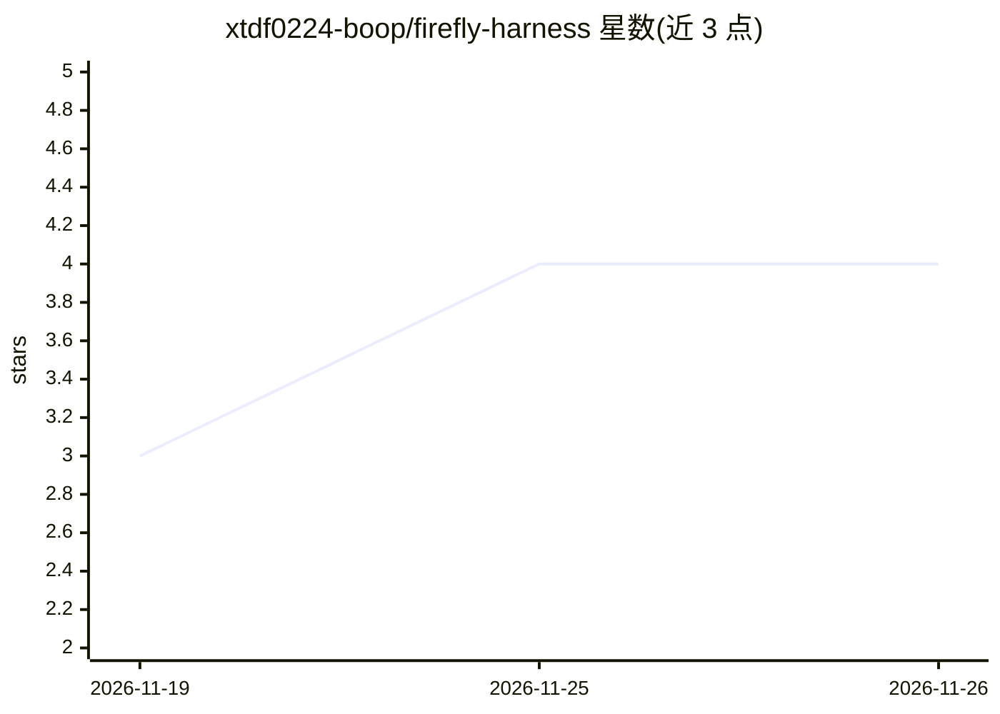

# xtdf0224-boop/firefly-harness

⭐ 4 · TypeScript · NOASSERTION · 推送 2026-11-08 · [GitHub](https://github.com/xtdf0224-boop/firefly-harness) · 个人维护 · 中文 README

**受流萤启发的 AI Agent 桌面工作台：给目标、看计划、确认执行**

Electron 桌面应用，提供闲聊与工作两种模式：工作模式下编排 Agent 制定计划、按步骤执行工具（读写文件、PowerShell 命令、网页抓取、浏览器操作），写文件与执行命令等操作进入「待确认操作」由用户批准。支持两种接入方式：驱动 Claude Code、Codex、Kimi Code 等命令行 Agent 的无头模式，或用 API 密钥直连，由应用自身实现工具循环。支持自定义 SKILL.md 技能、每 Agent 独立模型、桌宠与语音。仅提供 Windows 安装包/便携版；源码运行需 Node.js 24+。

## 筛选速览

| 维度 | 判定 | 备注 |
|---|---|---|
| AI 角色 | `ai-ecosystem` | LLM/agent 周边工具 |
| 许可风险 | `none` | NOASSERTION |
| 部署形态 | `desktop` | 安装包/桌面程序 |
| 模型依赖 | locked-api |  |
| 硬件要求 | — | 无带数字的原话,不猜 |
| 安装摩擦 | `low` | 无编译、无系统依赖或容器化 |
| 成熟度 | — | 结构信号不足 |

## 能力要点

- 命令行登录与 API 密钥两种模型接入方式，覆盖 8 家服务
- API 方式工具（文件、PowerShell 命令、网页、浏览器）由桌面进程自实现，逐步审批
- SKILL.md 技能导入，兼容 Claude Code / DeepSeek Harness 格式
- 流萤/萨姆双视觉模式、桌宠、看游戏画面与语音朗读

## 适用场景

- 把一个目标交给 Agent，逐项确认其写文件和执行命令
- 为不同 Agent 分配不同模型与推理强度协作完成任务
- 让桌宠在玩supported游戏时回答攻略问题

## 场景标签

`AI 助手` · 领域:对话与助手

## 证据(README 行号)

> L1: # 萤火 · Agent 工作台（Firefly Harness）
> L3: 以《崩坏：星穹铁道》角色「流萤 / 萨姆」为灵感的 AI Agent 桌面工作台：和流萤闲聊，或者把一个目标交给她——她会制定计划、调用工具、在关键操作前征求你的确认。可以接入 Claude、GPT、DeepSeek、Kimi、Qw
> L68: - **命令行方式**：萤火在你选的工作文件夹里驱动官方命令行 Agent（无头模式）。登录由那个工具自己完成：点「登录」会打开一个终端窗口，你在里面按提示登录，萤火不经手账号密码。Claude Code、Kimi Code、Qw

## 星数曲线

2026-11-19 3 → 2026-11-26 4（+1）

---
*卡片 v1 · prompt 1.4 · 生成 2026-11-21 · 置信度 high · 依据 README sha `0c95a79745da` · [字段定义](../../DATASET.md)*
