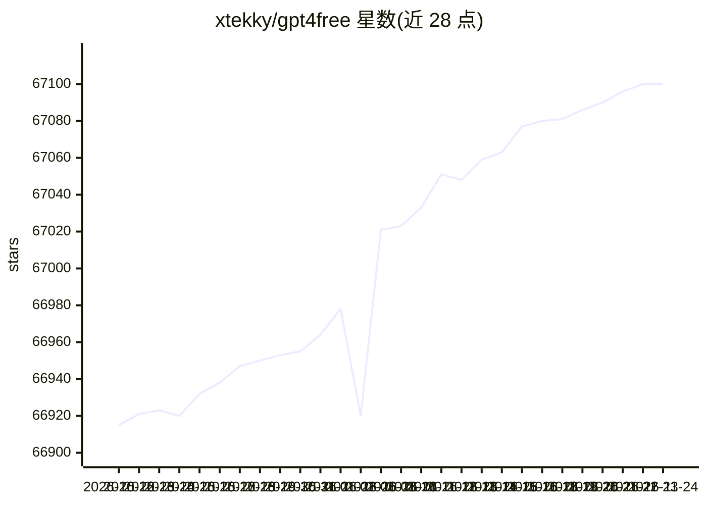

# xtekky/gpt4free

⭐ 67,097 · Python · GPL-3.0 · 推送 2026-11-11 · [GitHub](https://github.com/xtekky/gpt4free) · [官网](https://t.me/g4f_channel) · 组织维护

**为开发者聚合多供应商 LLM 访问的客户端与 API 项目**

GPT4Free 是一个社区驱动的多供应商聚合项目：将多个可访问的 LLM 与媒体生成供应商整合为统一接口，提供 Python 同步/异步客户端、浏览器 JS 客户端、可选本地 Web GUI，以及基于 FastAPI 的 OpenAI 兼容 REST API。另内置 MCP 服务器向 Claude 等 AI 助手暴露网页搜索、抓取与图像生成工具。安装支持 PyPI、Docker（full/slim/沙箱桌面镜像）与源码；部分供应商适配需 Chrome/Chromium 浏览器自动化，模型可用性取决于供应商能力。许可证为 GPL v3。

## 筛选速览

| 维度 | 判定 | 备注 |
|---|---|---|
| AI 角色 | `ai-ecosystem` | LLM/agent 周边工具 |
| 许可风险 | `viral` | GPL-3.0 |
| 部署形态 | `self-host` | docker 或自建部署 |
| 模型依赖 | — | README 未给出锁定关系 |
| 硬件要求 | — | 无带数字的原话,不猜 |
| 安装摩擦 | `low` | 无编译、无系统依赖或容器化 |
| 成熟度 | — | 结构信号不足 |

## 动量与使用信号

- 维护:`active` — 距上次 push 0.7 天,年发版 100,268 位贡献者
- 涨星:近 1 天 **+5**(自 20261016 起算)
- 安装:pypi 包 `g4f` 月下载 71,487
- 平台:WINDOWS / MACOS / LINUX · 协议:OPENAI-API / MCP

## 能力要点

- OpenAI 兼容 REST API（FastAPI）与 Python 同步/异步客户端
- 浏览器 JS 客户端 g4f.dev 分发，无需后端
- 内置 MCP 服务器（stdio/HTTP 模式），提供 web_search/web_scrape/image_generation 等工具
- Docker full/slim 镜像及含 100+ AI 工具菜单的沙箱桌面镜像

## 适用场景

- 通过统一 Python 客户端调用多个 LLM 供应商
- 部署 OpenAI 兼容 API 供自有应用接入
- 为 Claude Desktop 挂载 MCP 工具做网页搜索与图像生成
- 本地 Web GUI 进行聊天与媒体生成

## 场景标签

`聊天机器人` `图像生成` `模型网关` · 领域:Agent 开发

## 证据(README 行号)

> L17: GPT4Free (g4f) is a community-driven project that aggregates multiple accessible providers and interfaces to make w
> L27: - FastAPI-based OpenAI-compatible API (Inference API).
> L229: GPT4Free now includes a Model Context Protocol (MCP) server that allows AI assistants like Claude to access web se

## 星数曲线

2026-10-22 66,915 → 2026-11-24 67,100（+185）

---
*卡片 v1 · prompt 1.4 · 生成 2026-11-22 · 置信度 high · 依据 README sha `013c437b0ee4` · [字段定义](../../DATASET.md)*
