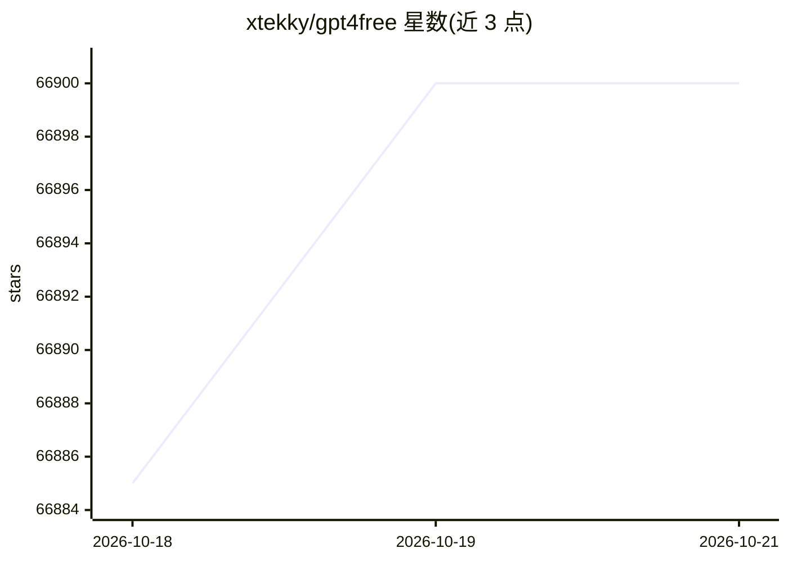

# xtekky/gpt4free

⭐ 66,900 · Python · GPL-3.0 · 推送 2026-10-19 · [GitHub](https://github.com/xtekky/gpt4free) · [官网](https://t.me/g4f_channel) · 个人维护

**聚合多家 LLM 提供商的接入层：统一 API、GUI 与客户端**

社区项目 g4f 聚合多个可访问的模型提供商（OpenAI 兼容端点、Gemini、MetaAI、Pollinations 媒体生成及本地推理后端），对外提供 OpenAI 兼容的 FastAPI Interference API、可选本地 Web GUI、Python/JS 客户端、CLI，以及供 AI 助手调用的 MCP 服务器（web 搜索、抓取、图像生成工具）。支持 Docker 全量与 slim 镜像部署（x86_64/arm64），部分提供商需要 Chrome/Chromium、API key 或 cookies/HAR 文件，遵循 GPL v3 许可。

## 筛选速览

| 维度 | 判定 | 备注 |
|---|---|---|
| AI 角色 | `ai-ecosystem` | LLM/agent 周边工具 |
| 许可风险 | `viral` | GPL-3.0 |
| 部署形态 | `self-host` | docker 或自建部署 |
| 模型依赖 | — | README 未给出锁定关系 |
| 硬件要求 | — | 无带数字的原话,不猜 |
| 安装摩擦 | `low` | 无编译、无系统依赖或容器化 |
| 成熟度 | — | 结构信号不足 |

## 动量与使用信号

- 维护:`active` — 距上次 push 0.7 天,年发版 100,268 位贡献者
- 涨星:近 1 天 **+5**(自 20261016 起算)
- 安装:pypi 包 `g4f` 月下载 71,487
- 平台:WINDOWS / MACOS / LINUX · 协议:OPENAI-API / MCP

## 能力要点

- 多提供商适配器：LLM、媒体生成与本地推理后端
- FastAPI 实现的 OpenAI 兼容 Interference API 与可选 Web GUI
- Python 同步/异步客户端与浏览器 JS 客户端
- MCP 服务器（stdio/HTTP 模式）提供 web_search/web_scrape/image_generation 工具

## 适用场景

- 用统一接口调用多个 LLM 与媒体生成提供商
- 为现有 OpenAI 兼容工作流提供统一入口端点
- 让 Claude 等 AI 助手通过 MCP 获得网页搜索与图像生成能力
- 在 Docker 中自托管 API 与 GUI 并做提供商登录管理

## 场景标签

`模型网关` · 领域:Agent 开发

## 证据(README 行号)

> L17: GPT4Free (g4f) is a community-driven project that aggregates multiple accessible providers and interfaces to make w
> L27: - FastAPI-based OpenAI-compatible API (Interference API).
> L296: ## Inference API (OpenAI‑compatible)

## 星数曲线

2026-10-18 66,885 → 2026-10-21 66,900（+15）

---
*卡片 v1 · prompt 1.4 · 生成 2026-10-20 · 置信度 high · 依据 README sha `e61f21748cbc` · [字段定义](../../DATASET.md)*
