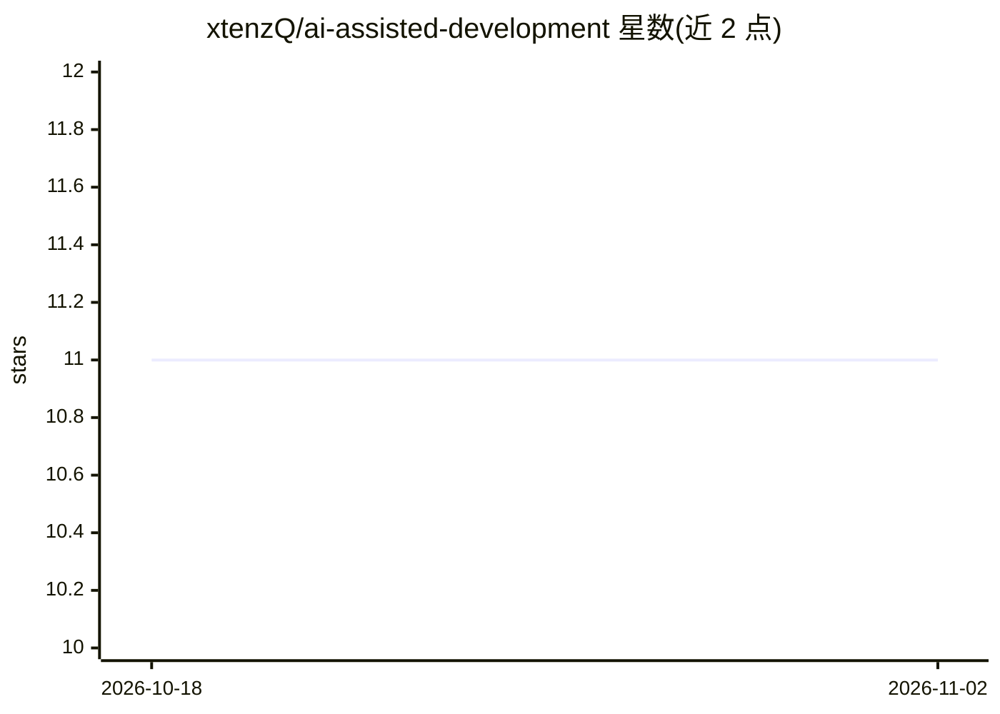

# xtenzQ/ai-assisted-development

⭐ 11 · Apache-2.0 · 推送 2026-02-12 · [GitHub](https://github.com/xtenzQ/ai-assisted-development) · 个人维护

**AI 编程代理实践指南：纪律化上下文与提示工程经验**

作者在公司引入 AI 辅助开发过程中整理的实践指南文章仓库，面向使用（而非构建）编码代理的工程师。内容涵盖 LLM 基础原理（无状态函数、温度、token 计量）、代理循环机制、从 12-Factor Agents 提炼的五个提示工程要素（掌控提示词、上下文窗口、工具调用检查点、小型专用代理）以及负面指令、输出模板等实操技巧。以 Markdown 文档形式提供，无代码安装步骤。

## 筛选速览

| 维度 | 判定 | 备注 |
|---|---|---|
| AI 角色 | `ai-knowledge` | 知识聚合/清单类 |
| 许可风险 | `permissive` | Apache-2.0 |
| 部署形态 | `None` |  |
| 模型依赖 | — | README 未给出锁定关系 |
| 硬件要求 | — | 无带数字的原话,不猜 |
| 安装摩擦 | `low` | 无编译、无系统依赖或容器化 |
| 成熟度 | — | 结构信号不足 |

## 能力要点

- 解释 LLM 无状态函数、token 计量与温度对编码任务的影响
- 提炼 12-Factor Agents 中五个适用于提示工程的要素
- 给出 Claude Code 的提示面（CLAUDE.md、自定义命令、代理定义）写法
- 负面指令与输出模板等实操提示技巧

## 适用场景

- 团队引入 AI 编程工具前梳理方法与风险
- 学习如何为编码代理写提示词与管理上下文
- 理解 AI 编码代理的底层工作机制

## 场景标签

`提示工程` `教程课程` · 领域:Agent 开发

## 证据(README 行号)

> L3: Thoughts on incorporating AI coding agents into real engineering workflows and what I learned so far.
> L5: I'm currently introducing AI-assisted development at the company I work at. This repository is my attempt to organiz

## 星数曲线

2026-10-18 11 → 2026-11-02 11（+0）

---
*卡片 v1 · prompt 1.4 · 生成 2026-11-01 · 置信度 high · 依据 README sha `a51476867329` · [字段定义](../../DATASET.md)*
