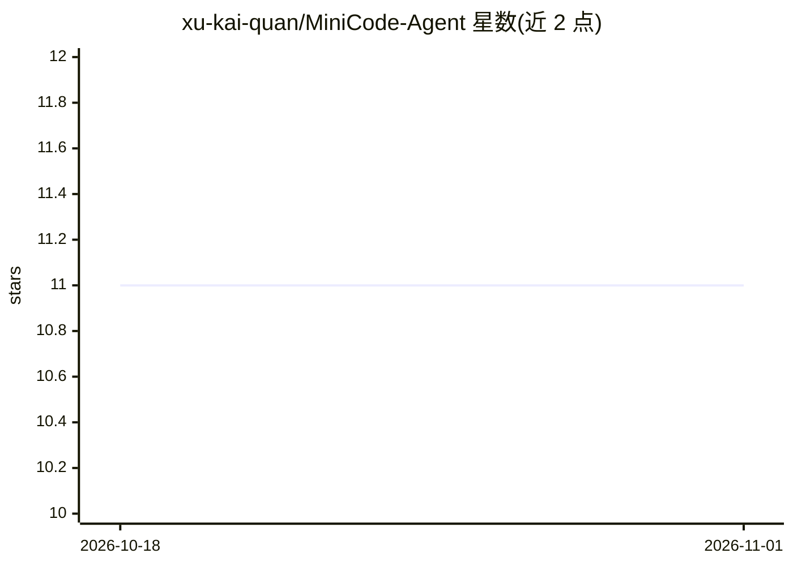

# xu-kai-quan/MiniCode-Agent

⭐ 11 · Python · 推送 2026-04-25 · [GitHub](https://github.com/xu-kai-quan/MiniCode-Agent) · 个人维护 · 中文 README

**单文件教学版本地编码 agent：无框架展示 ReAct 原理**

一个面向学习者的最小化编码 agent 项目：每版仅一个 Python 文件，从 30 行 ReAct 循环的 01 版迭代到含 context 压缩的 08 活跃版，共八个版本（七个封存快照），逐步引入沙箱、乐观锁、流式、双后端、子 agent、session 持久化与 history 自动压缩。默认通过本地 Ollama 跑 qwen2.5-coder:7b，可切换云端 MiniMax-M2.7；04 起运行时仅依赖 stdlib。作者明确声明不适合生产、不是框架、不支持并行多 agent。

## 筛选速览

| 维度 | 判定 | 备注 |
|---|---|---|
| AI 角色 | `ai-native` | 本体是模型或模型工具 |
| 许可风险 | `none` | — |
| 部署形态 | `library` | 以包/库形式分发 |
| 模型依赖 | local-ok | 支持本地模型 |
| 硬件要求 | — | 无带数字的原话,不猜 |
| 安装摩擦 | `low` | 无编译、无系统依赖或容器化 |
| 成熟度 | — | 结构信号不足 |

## 能力要点

- 八个迭代版本，每版一个 Python 文件，ReAct 循环约 30 行
- 08 版支持 history 自动压缩（70% 阈值触发 LLM 总结，失败降级机械裁剪）
- 双后端：本地 Ollama 默认 7B 模型，可切云端 MiniMax-M2.7
- 04 起运行时仅 Python stdlib，04-08 共 104 个 pytest 且 CI 全覆盖

## 适用场景

- 想读懂 AI agent 内部 ReAct 循环原理的学习者逐版读源码
- 对比小模型与云端大模型在 agent 场景下的失败模式
- 参考 context 压缩、session 持久化、子 agent 等机制的实现

## 场景标签

`教程课程` · 领域:学习与行业

## 证据(README 行号)

> L3: > 一个**最小化编码 agent**, 单文件实现, 没有任何框架封装, 适合用来理解 "AI agent 到底是怎么工作的". 从最小可跑的 30 行 ReAct 循环, 一路迭代到流式 + 双后端 + token 可见的实用体
> L127: 1. **循环就是 agent 的全部本质** — 模型输出 → 解析工具调用 → 执行 → 把结果喂回去, 直到模型不再调工具。仅此而已。

## 星数曲线

2026-10-18 11 → 2026-11-01 11（+0）

---
*卡片 v1 · prompt 1.4 · 生成 2026-11-01 · 置信度 mid · 依据 README sha `6cbb3b9f7180` · [字段定义](../../DATASET.md)*
