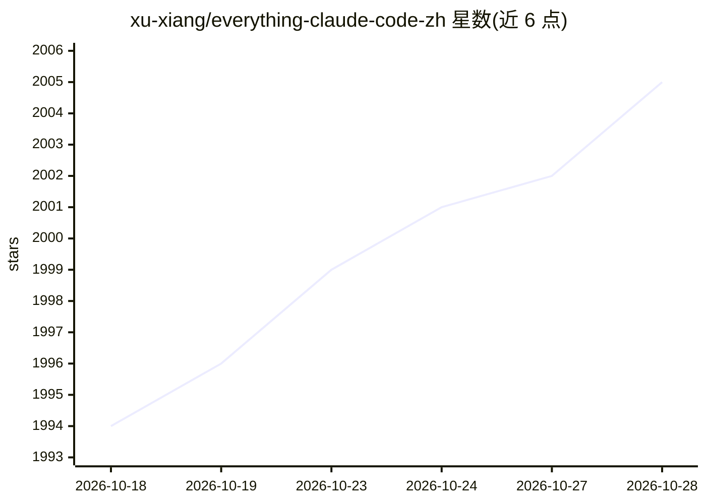

# xu-xiang/everything-claude-code-zh

⭐ 2,006 · JavaScript · MIT · 推送 2026-03-05 · [GitHub](https://github.com/xu-xiang/everything-claude-code-zh) · [官网](https://oneskill.one) · 个人维护 · 中文 README

**Claude Code 配置系统的中文翻译：智能体/技能/钩子/命令/规则集合**

everything-claude-code 的中文翻译项目，收录为 AI 智能体框架打造的生产级配置系统：13 个子智能体、56 个技能、32 个命令，以及钩子、多语言规则和 MCP 配置，源自约 10 个月日常使用演化。可作 Claude Code 插件安装或手动复制组件，兼容 Cursor、OpenCode、Codex 等框架；附带 AgentShield 安全审计、持续学习本能系统与技能生成器。要求 Claude Code CLI v2.1.0+，规则部分因插件系统限制需手动安装。

## 筛选速览

| 维度 | 判定 | 备注 |
|---|---|---|
| AI 角色 | `ai-ecosystem` | LLM/agent 周边工具 |
| 许可风险 | `permissive` | MIT |
| 部署形态 | `self-host` | docker 或自建部署 |
| 模型依赖 | — | README 未给出锁定关系 |
| 硬件要求 | — | 无带数字的原话,不猜 |
| 安装摩擦 | `low` | 无编译、无系统依赖或容器化 |
| 成熟度 | — | 结构信号不足 |

## 能力要点

- 13 个智能体、56 个技能、32 个命令的插件化配置集合
- 支持 Claude Code / Cursor / OpenCode / Codex 跨平台使用
- AgentShield 安全扫描（npx ecc-agentshield scan）与持续学习本能系统
- 规则按 common/typescript/python/golang 目录组织，可只装所需语言

## 适用场景

- 为 Claude Code 安装一整套智能体与工作流配置
- 通过 /security-scan 审计 Claude Code 配置的安全风险
- 从 git 历史生成可复用的 SKILL.md 技能

## 场景标签

`精选清单` `提示工程` · 领域:Agent 开发

## 证据(README 行号)

> L24: 这不仅仅是配置文件。它是一个完整的系统：包含技能（Skills）、本能（Instincts）、内存优化、持续学习、安全扫描以及研究优先的开发模式。这些生产级的智能体（Agents）、钩子（Hooks）、命令（Commands）、规
> L26: 适用于 **Claude Code**, **Codex**, **Cowork** 以及其他 AI 智能体框架。
> L135: ✨ **完成！** 你现在可以访问 13 个智能体（Agents）、56 个技能（Skills）和 32 个命令（Commands）。

## 星数曲线

2026-10-18 1,994 → 2026-10-28 2,005（+11）

---
*卡片 v1 · prompt 1.4 · 生成 2026-10-21 · 置信度 mid · 依据 README sha `33aef8187f25` · [字段定义](../../DATASET.md)*
