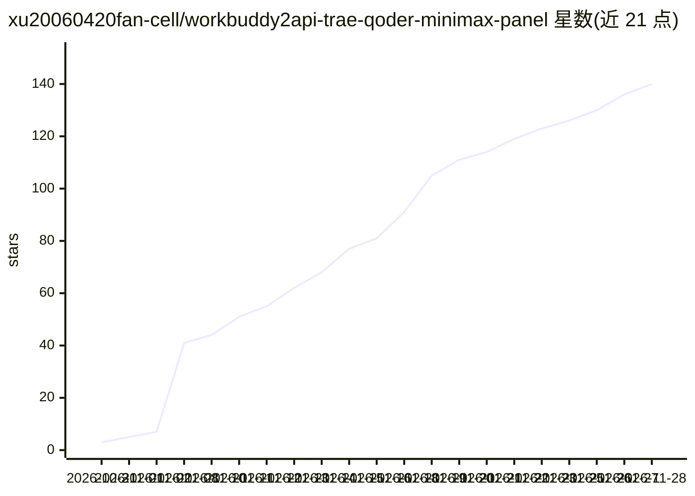

# xu20060420fan-cell/workbuddy2api-trae-qoder-minimax-panel

⭐ 140 · Go · MIT · 推送 2026-11-25 · [GitHub](https://github.com/xu20060420fan-cell/workbuddy2api-trae-qoder-minimax-panel) · 个人维护 · 中文 README

**自托管多平台账号池网关：统一 OpenAI 兼容接口与管理面板**

Go 编写的自托管账号管理面板与 OpenAI 兼容网关，聚合 WorkBuddy、CodeBuddy、Trae、Qoder、MiniMax、豆包、华为云 CodeArts 账号及 Google Gemini 官方 Key。提供账号池轮转、切号、冷却熔断、会话粘性、每日签到保活与任务中心；网关暴露 chat/completions、Responses 与模型列表接口，支持 SSE 流式。模型名前缀区分平台。限制：仅供本人账号自用，不支持共享号池与付费服务；CodeArts 因接口变动频繁仅承诺尽力维护。

## 筛选速览

| 维度 | 判定 | 备注 |
|---|---|---|
| AI 角色 | `ai-ecosystem` | LLM/agent 周边工具 |
| 许可风险 | `permissive` | MIT |
| 部署形态 | `desktop` | 安装包/桌面程序 |
| 模型依赖 | — | README 未给出锁定关系 |
| 硬件要求 | — | 无带数字的原话,不猜 |
| 安装摩擦 | `low` | 无编译、无系统依赖或容器化 |
| 成熟度 | `idea` | |

## 能力要点

- 多平台账号聚合：OAuth/浏览器授权登录、账号池轮转与一键切号
- OpenAI 兼容网关：chat/completions、Responses 接口与 SSE 流式
- 每日签到、保活与任务中心自动领取
- 冷却熔断与会话粘性的账号池调度

## 适用场景

- 把多个编码助手账号统一暴露成 OpenAI 兼容接口供本地工具调用
- 自托管管理个人各平台账号的签到与保活
- 接入 Gemini 官方 Key 并与其他平台统一分组管理

## 场景标签

`模型网关` · 领域:Agent 开发

## 证据(README 行号)

> L5: 一个自托管的账号管理面板和 OpenAI 兼容网关。用 Web 面板管理自己的 WorkBuddy、CodeBuddy、Trae、Qoder、MiniMax、豆包和华为云 CodeArts 账号，也可以接入 Google Gemin
> L47: - 网关提供聊天补全、Responses 和模型列表，支持 SSE 流式响应。账号池支持轮转、会话粘性、冷却与熔断。

## 星数曲线

2026-10-31 3 → 2026-11-28 140（+137）

---
*卡片 v1 · prompt 1.4 · 生成 2026-11-28 · 置信度 high · 依据 README sha `0687d64bc864` · [字段定义](../../DATASET.md)*
