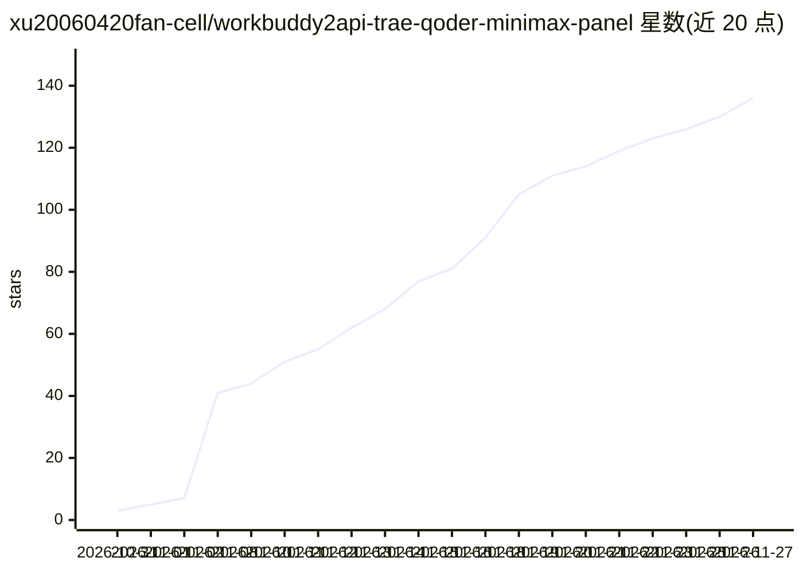

# xu20060420fan-cell/workbuddy2api-trae-qoder-minimax-panel

⭐ 136 · Go · MIT · 推送 2026-11-25 · [GitHub](https://github.com/xu20060420fan-cell/workbuddy2api-trae-qoder-minimax-panel) · 个人维护 · 中文 README

**多平台 AI 编程账号合集的 OpenAI 兼容网关与 Web 管理面板**

自托管 Go 实现的 OpenAI 兼容反向代理网关，将 WorkBuddy/CodeBuddy、Trae、Qoder、MiniMax、豆包、华为云 CodeArts 及 Gemini 官方 Key 等多平台账号统一包装为 /v1/chat/completions 与 /v1/responses 端点，模型按 realm 前缀分流。面向个人多账号场景：账号池轮转、一键切号、熔断冷却、会话粘性、全平台每日签到保活与成长任务一键完成（国服 18 项）。内嵌九视图 Web 面板。声明为 Sliverkiss/workbuddy2api 的增强分支，上游已删库；仅限自用账号，禁止批量小号分发与售卖，凭证明文存于本机。

## 筛选速览

| 维度 | 判定 | 备注 |
|---|---|---|
| AI 角色 | `ai-ecosystem` | LLM/agent 周边工具 |
| 许可风险 | `permissive` | MIT |
| 部署形态 | `desktop` | 安装包/桌面程序 |
| 模型依赖 | — | README 未给出锁定关系 |
| 硬件要求 | — | 无带数字的原话,不猜 |
| 安装摩擦 | `low` | 无编译、无系统依赖或容器化 |
| 成熟度 | — | 结构信号不足 |

## 能力要点

- 账号池轮转 + 断路冷却 + 会话粘性的多账号调度
- 全平台一键签到、保活与成长任务自动化（国服 18 项，含判据事件链构造）
- 统一 OpenAI 兼容端点，模型按 cn:/global:/trae:/minimax:/gemini: 前缀分流
- 内嵌九视图 Web 管理面板（账号运维/签到池/用量分析/热改配置/运行日志）

## 适用场景

- 把自己手上多个平台的 AI 编程账号统一成一个 OpenAI 兼容入口给本地工具用
- 自动完成各平台每日签到、保活与成长任务，汇总积分与余额
- 多账号场景下单号故障自动换号、限流熔断防雪崩

## 场景标签

`模型网关` · 领域:Agent 开发

## 证据(README 行号)

> L115: WorkBuddy2API 是一个自托管的 **OpenAI 兼容反向代理网关**，将腾讯 CodeBuddy（`copilot.tencent.com`）账号包装为统一的 `/v1/chat/completions` 服务。
> L52: > - 模型按 **realm 前缀**分流：`cn:`（国服 CodeBuddy）、`global:`（国际版）、`trae:`（Trae 通道）、`minimax:`（MiniMax 通道）、`gemini:`（Google 

## 星数曲线

2026-10-31 3 → 2026-11-27 136（+133）

---
*卡片 v1 · prompt 1.4 · 生成 2026-11-18 · 置信度 mid · 依据 README sha `647e23f042c3` · [字段定义](../../DATASET.md)*
