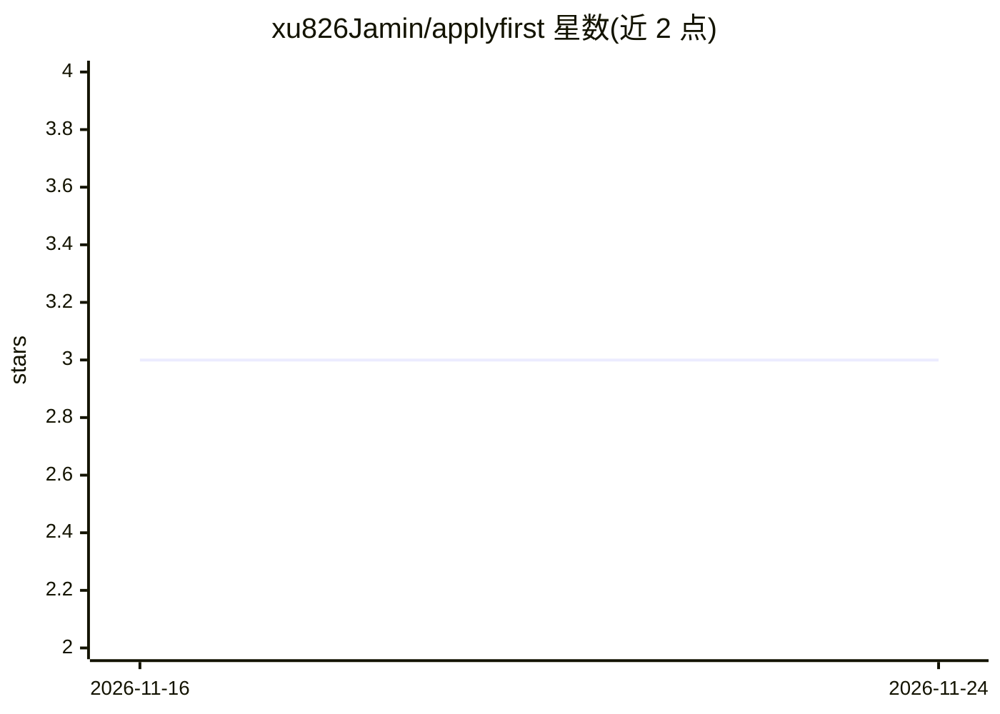

# xu826Jamin/applyfirst

⭐ 3 · Python · AGPL-3.0 · 推送 2026-11-22 · [GitHub](https://github.com/xu826Jamin/applyfirst) · 个人维护

**求职者用 Claude 抓新职位并自动填写投递申请**

本地运行的求职自动化工具：直接轮询数千个公司招聘板（Greenhouse、Lever、Ashby、Workday 等）获取最新职位，按地点、职级、关键词等条件过滤并排序；将简历转为经验库后由 Claude 在浏览器中填写并提交申请表，支持提交前人工检查的 review 模式与自动提交的 auto 模式；读取邮箱回复并与申请匹配，统计各来源/简历的面试率。需 Python 3.10+、Claude Code 与 Chromium 系浏览器，表单填写按 Claude 用量计费（单次约 $0.37），内置每日 $10 消费上限。数据全部存于本地 ~/.applyfirst，主打加拿大/美国科技类实习与新毕业生岗位。

## 筛选速览

| 维度 | 判定 | 备注 |
|---|---|---|
| AI 角色 | `ai-native` | 本体是模型或模型工具 |
| 许可风险 | `viral` | AGPL-3.0 |
| 部署形态 | `library` | 以包/库形式分发 |
| 模型依赖 | locked-api |  |
| 硬件要求 | — | 无带数字的原话,不猜 |
| 安装摩擦 | `low` | 无编译、无系统依赖或容器化 |
| 成熟度 | — | 结构信号不足 |

## 能力要点

- 直接读取 Greenhouse/Lever/Ashby/Workday 等数千个公司招聘板的最新职位
- Claude 在浏览器中填写申请表（含 Workday），生成内容可溯源到用户确认的经验库
- 读取邮箱回复并与申请匹配，按来源/简历/领域统计面试率
- 本地运行，简历与数据存于 ~/.applyfirst，不外传

## 适用场景

- 每天第一时间获取新发布的技术实习/校招职位并抢先投递
- 让 Claude 批量填写 Workday 等申请表并保存确认记录
- 追踪哪些投递渠道和简历版本带来面试邀请

## 场景标签

`浏览器自动化` `网页抓取` `工作流自动化` · 领域:效率与自动化

## 证据(README 行号)

> L6: applyfirst checks thousands of company career boards directly, puts the newest postings that
> L49: - **Applications filled for you.** Claude fills the form in your browser, including Workday.

## 星数曲线

2026-11-16 3 → 2026-11-24 3（+0）

---
*卡片 v1 · prompt 1.4 · 生成 2026-11-21 · 置信度 high · 依据 README sha `d62d79dd32da` · [字段定义](../../DATASET.md)*
