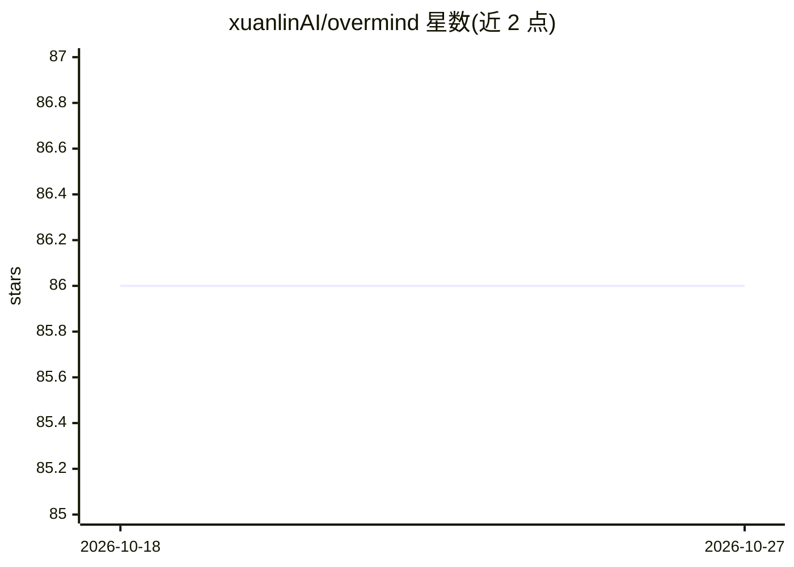

# xuanlinAI/overmind

⭐ 86 · JavaScript · MIT · 推送 2026-06-05 · [GitHub](https://github.com/xuanlinAI/overmind) · 个人维护 · 中文 README

**Claude Code 的外挂认知引擎：跨会话记忆与多 Agent 共享大脑**

面向 Claude Code 等 AI 编码 Agent 的外挂认知系统：66 个模块经 6 条通道与事件总线互连，提供 5 层记忆（SQLite+FTS5 语义检索、程序性模板晋升、情景摘要）、10 种关系的知识图谱被动推理、37 阶段分析管道（红队审查、反事实引擎、预算拦截等）、20 个 MCP 工具及舰队模式（多 CC 实例自发现与共享上下文）。安装为 git clone 后运行 node install.js，自动检测 CC/Cursor/Aider/Codex/Gemini 等 Agent，需设置 DEEPSEEK_API_KEY。跨平台，声明本地运行、日均 API 成本 $0.05-0.15。README 含与 Mem0/AgentMemory 的对比表。

## 筛选速览

| 维度 | 判定 | 备注 |
|---|---|---|
| AI 角色 | `ai-ecosystem` | LLM/agent 周边工具 |
| 许可风险 | `permissive` | MIT |
| 部署形态 | `desktop` | 安装包/桌面程序 |
| 模型依赖 | locked-api |  |
| 硬件要求 | — | 无带数字的原话,不猜 |
| 安装摩擦 | `low` | 无编译、无系统依赖或容器化 |
| 成熟度 | — | 结构信号不足 |

## 能力要点

- 5 层记忆系统 + 10 种关系知识图谱（4,500+ 节点）被动推理
- 20 个 MCP 工具，含 fleet_status/fleet_peek 舰队查询
- 37 阶段分析管道：红队审查、反事实引擎、预算拦截、TDD 约束
- node install.js 一键安装，自动检测 CC/Cursor/Aider/Codex/Gemini

## 适用场景

- 让 Claude Code 等编码 Agent 跨会话保留记忆
- 多个 CC 实例间共享上下文与技能协同
- 提交前自动红队审查代码并执行安全拦截

## 场景标签

`多智能体` `知识图谱` `Agent 记忆` · 领域:Agent 开发

## 证据(README 行号)

> L19: 玄霖超脑 v4（无量网络）是 Claude Code 的外挂认知引擎。66 个模块通过 6 条通道 + 事件总线实时互连，形成 AI 界首个认知神经系统。
> L31: |**AI Agent 适配**|仅 Claude Code|自动检测 CC/Cursor/Aider/Codex/Gemini|
> L138: `search_memory` · `save_memory` · `list_skills` · `create_skill` · `memory_stats` · `current_context` · `hermes_fu

## 星数曲线

2026-10-18 86 → 2026-10-27 86（+0）

---
*卡片 v1 · prompt 1.4 · 生成 2026-10-23 · 置信度 mid · 依据 README sha `c6e69322c278` · [字段定义](../../DATASET.md)*
