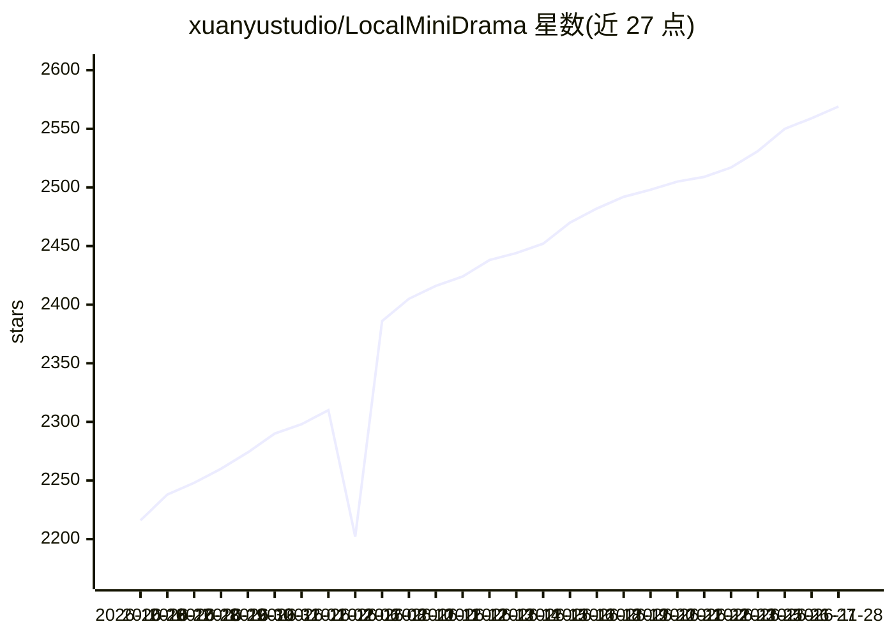

# xuanyustudio/LocalMiniDrama

⭐ 2,569 · JavaScript · MIT · 推送 2026-11-27 · [GitHub](https://github.com/xuanyustudio/LocalMiniDrama) · [官网](https://83zi.com/) · 个人维护 · 中文 README

**面向内容创作者的本地离线 AI 短剧/漫剧一站式生成工具**

基于 Electron + Vue 3 + Node.js/SQLite 的本地短剧制作平台：从故事梗概生成多集剧本，自动提取角色/场景/道具并生成形象图，再逐镜生成分镜脚本、静帧与视频片段，最后合成完整剧集。数据存储于本地 SQLite 与本地文件，通过用户自有的 AI API Key 调用多家图片/视频/文本服务商。提供列表与画布双视图、一键流水线、失败自动重试与工程 ZIP 导出导入。Windows 提供 exe 安装包，也可从源码运行。

## 筛选速览

| 维度 | 判定 | 备注 |
|---|---|---|
| AI 角色 | `ai-native` | 本体是模型或模型工具 |
| 许可风险 | `permissive` | MIT |
| 部署形态 | `desktop` | 安装包/桌面程序 |
| 模型依赖 | local-ok | 支持本地模型 |
| 硬件要求 | — | 无带数字的原话,不猜 |
| 安装摩擦 | `medium` | 含编译或系统依赖之一 |
| 成熟度 | — | 结构信号不足 |

## 能力要点

- 全流程：故事→角色/场景→分镜→视频合成，支持一键流水线与整组重跑
- 列表+画布双视图编辑，画布支持节点生成与工作流框选
- 多服务商接入：通义/火山/可灵/Gemini/Vidu 及 OpenAI 兼容接口
- 本地优先：SQLite + 本地文件存储，支持 16:9/9:16/1:1 画幅

## 适用场景

- 批量生产 AI 短剧或漫剧内容
- 剧本素材不上云，本机完成生成与合成
- 通过画布工作流批量管理分镜生成

## 场景标签

`视频生成` `图像生成` · 领域:内容生成

## 证据(README 行号)

> L27: 本项目用纯 JavaScript 从零搭建，接入你自己的 AI API，打开即可生成完整 AI 短剧。
> L148: |阿里云 DashScope（通义）|✅|✅|✅|
> L162: ├── backend-node/     # Express + SQLite，生成/合成/导入导出

## 星数曲线

2026-10-26 2,216 → 2026-11-28 2,569（+353）

---
*卡片 v1 · prompt 1.4 · 生成 2026-11-28 · 置信度 high · 依据 README sha `ae817d436c01` · [字段定义](../../DATASET.md)*
