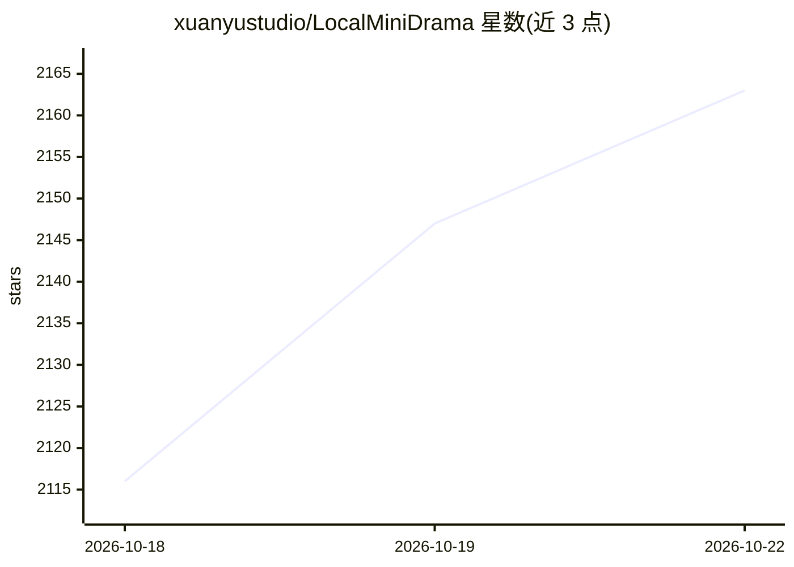

# xuanyustudio/LocalMiniDrama

⭐ 2,163 · JavaScript · MIT · 推送 2026-10-21 · [GitHub](https://github.com/xuanyustudio/LocalMiniDrama) · [官网](https://83zi.com/) · 个人维护 · 中文 README

**本地运行的 AI 短剧/漫剧生成工具，剧本到成片一站式**

基于 Electron + Vue 3 + Node.js/SQLite 的本地短剧创作工具：输入故事梗概后，AI 生成多集剧本，提取并生成角色、场景、道具图，按集生成分镜脚本，逐镜生成图片与视频，最后合成完整剧集文件。支持画布工作流可视化编排与整组重跑。数据本地存储不上云，生成能力通过配置多家 AI 服务商 API Key 实现（通义/火山/可灵/Gemini/Vidu 等，文本可接 Ollama）。Windows 提供 exe 安装包，源码运行需 Node.js ≥ 18。

## 筛选速览

| 维度 | 判定 | 备注 |
|---|---|---|
| AI 角色 | `ai-native` | 本体是模型或模型工具 |
| 许可风险 | `permissive` | MIT |
| 部署形态 | `desktop` | 安装包/桌面程序 |
| 模型依赖 | local-ok | 支持本地模型 |
| 硬件要求 | — | 无带数字的原话,不猜 |
| 安装摩擦 | `medium` | 含编译或系统依赖之一 |
| 成熟度 | — | 结构信号不足 |

## 能力要点

- 剧本→角色/场景/道具→分镜→视频合成的全自动流水线，失败自动重试 3 次
- 画布工作流（LibTV 式）双视图编排，支持工作流整组重跑
- 支持 8 类 AI 服务商接入，三类模型（图/视频/文本）独立配置
- 本地优先 SQLite + 本地文件存储，素材不上云

## 适用场景

- 内容创作者批量生产 AI 短剧或漫剧成片
- 素材与剧本需要完全留在本机的隐私敏感场景
- 开发者二次开发或接入新的 AI 服务商

## 场景标签

`视频生成` `图像生成` · 领域:内容生成

## 证据(README 行号)

> L22:  🎬 全流程 剧本 → 角色/场景 → 分镜 → 视频合成
> L84: |7|**图片/视频生成**|逐镜生成静帧图与视频片段|

## 星数曲线

2026-10-18 2,116 → 2026-10-22 2,163（+47）

---
*卡片 v1 · prompt 1.4 · 生成 2026-10-21 · 置信度 high · 依据 README sha `de57e9be55f6` · [字段定义](../../DATASET.md)*
