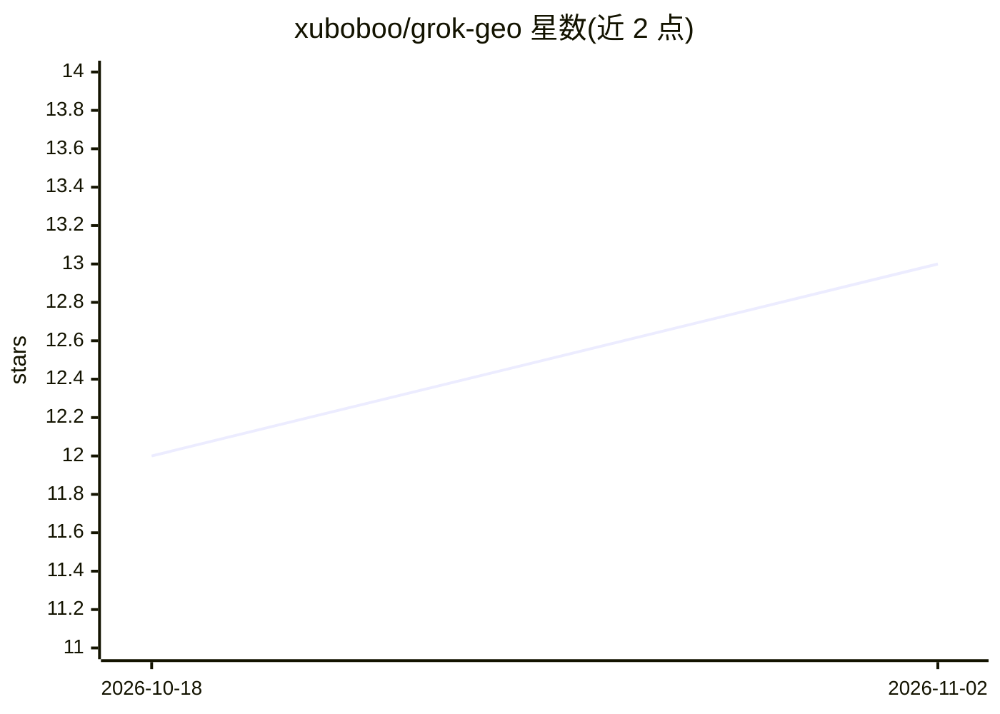

# xuboboo/grok-geo

⭐ 13 · Python · MIT · 推送 2026-07-19 · [GitHub](https://github.com/xuboboo/grok-geo) · [官网](https://github.com/xuboboo/grok-geo) · 个人维护 · 中文 README

**面向品牌营销者的 AI 搜索（GEO）品牌可见度诊断 Agent Skill**

一个可安装到 Cursor / Claude Code 等 Agent 环境的 GEO（生成式引擎优化）诊断技能：通过 SKILL.md 定义工作流，对指定品牌在 17+ 个 AI 搜索/问答引擎（ChatGPT、豆包、DeepSeek、Kimi、Gemini 等）中的可见度、引用准确性、竞品差距、情感倾向进行审计，基于 60+ 项确定性指标与 92 条合规规则输出评分报告（report.md/json、问题清单、机会清单）。实时搜索由 Agent 的 web_search 工具完成，确定性计算脚本不发起网络请求；另提供离线演示模式、定期监控调度脚本与 unittest 测试。要求 Python 3.11+，MIT 许可。

## 筛选速览

| 维度 | 判定 | 备注 |
|---|---|---|
| AI 角色 | `ai-native` | 本体是模型或模型工具 |
| 许可风险 | `permissive` | MIT |
| 部署形态 | `library` | 以包/库形式分发 |
| 模型依赖 | — | README 未给出锁定关系 |
| 硬件要求 | — | 无带数字的原话,不猜 |
| 安装摩擦 | `low` | 无编译、无系统依赖或容器化 |
| 成熟度 | — | 结构信号不足 |

## 能力要点

- 17+ AI 引擎适配，覆盖国际与国内主流平台
- 60+ 项确定性指标与 92 条合规规则的品牌 GEO 评分
- 支持 Cursor / Claude Code 技能目录安装与对话触发
- 离线演示、自定义品牌审计、定期监控三种使用场景

## 适用场景

- 审计我的品牌在各 AI 搜索引擎中被提及与引用的表现
- 对比竞品在生成式搜索中的可见度差距
- 按周期持续追踪品牌的 GEO 评分变化
- 获取可执行的 GEO 优化建议与优先级清单

## 场景标签

`数据分析` · 领域:效率与自动化

## 证据(README 行号)

> L10: 通用 GEO Agent Skill，支持 17+ AI 引擎的品牌可见度诊断。提供引用准确性验证、竞争对手对比和内容差距分析。
> L35: │   ├── SKILL.md             # Agent 工作流定义
> L50: **输出文件**：`report.md`（可读报告）、`report.json`（结构化数据）、`questions.csv`、`evidence.csv`、`opportunities.csv`、`manifest.json`

## 星数曲线

2026-10-18 12 → 2026-11-02 13（+1）

---
*卡片 v1 · prompt 1.4 · 生成 2026-10-31 · 置信度 low · 依据 README sha `d744b706d085` · [字段定义](../../DATASET.md)*
