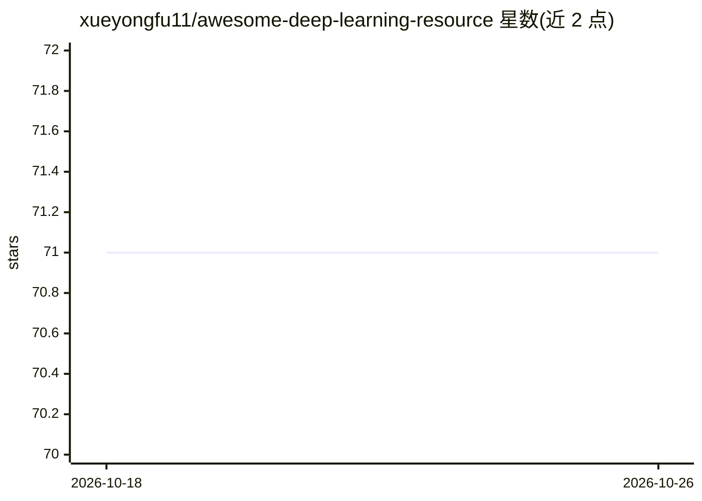

# xueyongfu11/awesome-deep-learning-resource

⭐ 71 · 推送 2026-09-27 · [GitHub](https://github.com/xueyongfu11/awesome-deep-learning-resource) · 个人维护 · 中文 README

**个人深度学习论文笔记与开源资源分类整理仓库**

个人维护的深度学习资料整理仓库：以目录形式组织大模型与智能体（LLM、Agent、RAG、RLHF、PEFT、量化、推理加速）、多模态与语音、训练工程（CUDA、数据集、论文写作）、CV 与知识图谱、传统 NLP 任务等五大类专题。每个专题目录下包含综述、论文阅读笔记、工程实践或数据集整理；使用说明约定新增内容的归类方式与大模型内容前置原则。仓库本身不提供可运行代码或安装方式。

## 筛选速览

| 维度 | 判定 | 备注 |
|---|---|---|
| AI 角色 | `ai-knowledge` | 知识聚合/清单类 |
| 许可风险 | `none` | — |
| 部署形态 | `None` |  |
| 模型依赖 | — | README 未给出锁定关系 |
| 硬件要求 | — | 无带数字的原话,不猜 |
| 安装摩擦 | `medium` | 含编译或系统依赖之一 |
| 成熟度 | — | 结构信号不足 |

## 能力要点

- 按大模型/多模态/训练工程/CV/传统NLP 五大类组织专题目录
- 覆盖 LLM、Agent、RAG、RLHF、PEFT、量化、VLA 等方向的论文笔记
- 包含数据集、评测与高性能计算（CUDA/Triton/NCCL）资料

## 适用场景

- 按专题查找深度学习各方向的论文阅读笔记
- 了解大模型、Agent、多模态等领域的资料与仓库收录
- 查找数据集与训练工程相关资料

## 场景标签

`精选清单` · 领域:学习与行业

## 证据(README 行号)

> L3: 深度学习、自然语言处理、大模型与多模态相关资料整理。
> L58: - 每个专题目录下通常包含该方向的综述、论文笔记、工程实践或数据集整理。

## 星数曲线

2026-10-18 71 → 2026-10-26 71（+0）

---
*卡片 v1 · prompt 1.4 · 生成 2026-10-24 · 置信度 high · 依据 README sha `5d45a320b337` · [字段定义](../../DATASET.md)*
