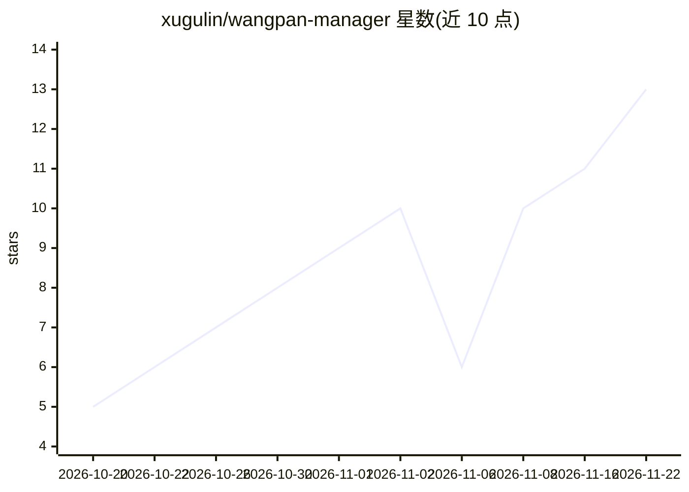

# xugulin/wangpan-manager

⭐ 13 · Python · 推送 2026-09-22 · [GitHub](https://github.com/xugulin/wangpan-manager) · [官网](https://github.com/xugulin/wangpan-manager) · 个人维护 · 中文 README

**免安装桌面网盘管家：跨网盘互传、在线播放与 AI 字幕**

以解压即用的绿色桌面应用形式，把百度网盘、夸克网盘、光鸭云盘统一到一个界面管理，提供跨网盘互传、在线视频播放（VLC 嵌入，支持 4K）、AI 字幕（含本地语音识别模型）等能力。内置便携版 ollama 运行时作为本地小模型基座，也可通过 AI 页下载模型离线使用。提供 Windows 与 Linux 两平台整包下载，不要求装 Python 或管理员权限；视频播放依赖包内或系统的 VLC 运行时。

## 筛选速览

| 维度 | 判定 | 备注 |
|---|---|---|
| AI 角色 | `ai-enhanced` | 去掉 AI 部分产品仍成立 |
| 许可风险 | `none` | — |
| 部署形态 | `desktop` | 安装包/桌面程序 |
| 模型依赖 | local-ok | 支持本地模型 |
| 硬件要求 | — | 无带数字的原话,不猜 |
| 安装摩擦 | `medium` | 含编译或系统依赖之一 |
| 成熟度 | — | 结构信号不足 |

## 能力要点

- 百度/夸克/光鸭三网盘统一界面管理，支持跨网盘互传
- VLC 嵌入式在线播放，Windows 包自带官方 VLC 3.0.23 运行时
- 内置 ollama 便携版基座（CPU/Vulkan），支持本地模型离线使用
- AI 字幕模型首次使用时自动联网下载，之后离线可用

## 适用场景

- 在一个界面里管理百度、夸克等多个网盘账号
- 直接在线播放网盘里的 4K 视频
- 用本地模型给视频生成字幕

## 场景标签

`语音识别` · 领域:感知与多模态

## 证据(README 行号)

> L3: **一个绿色免安装的网盘管家：百度网盘 · 夸克网盘 · 光鸭云盘，一个界面全搞定**
> L26: > 不想联网可以自己在 AI 页里装一次，之后离线可用。**本地小模型的 ollama 基座（官方便携版
> L27: > 运行时）已经内置**：解压即用，不用自己装 ollama、不需要管理员权限；包里只有基座、

## 星数曲线

2026-10-20 5 → 2026-11-22 13（+8）

---
*卡片 v1 · prompt 1.4 · 生成 2026-11-18 · 置信度 high · 依据 README sha `b3f2e1e6765c` · [字段定义](../../DATASET.md)*
