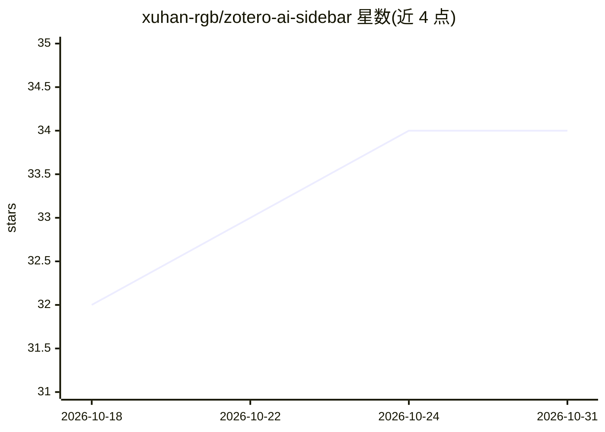

# xuhan-rgb/zotero-ai-sidebar

⭐ 34 · TypeScript · AGPL-3.0 · 推送 2026-10-27 · [GitHub](https://github.com/xuhan-rgb/zotero-ai-sidebar) · 个人维护 · 中文 README

**Zotero 内置的论文 AI 研究助手侧栏插件**

面向 Zotero 7–10 的研究助手插件：在侧栏中就当前论文提问，插件读取 PDF（arXiv 论文取 LaTeX 源），展示工具调用过程，可将回答写回笔记或生成 PDF 高亮。支持 API 模式（Anthropic、OpenAI 或 OpenAI 兼容端点）与 WEB 模式（通过本地 Web Agent 镜像 ChatGPT、DeepSeek、Kimi 等网站对话，需 Node.js 20+ 与浏览器）。另含全文总览生成、@素材引用、沉浸式 PDF 翻译、Quick Ask 临时会话等功能；设置与历史本地存储，可选 WebDAV 同步。以 .xpi 文件安装，无 Docker/桌面安装包。

## 筛选速览

| 维度 | 判定 | 备注 |
|---|---|---|
| AI 角色 | `ai-native` | 本体是模型或模型工具 |
| 许可风险 | `viral` | AGPL-3.0 |
| 部署形态 | `desktop` | 安装包/桌面程序 |
| 模型依赖 | locked-api |  |
| 硬件要求 | — | 无带数字的原话,不猜 |
| 安装摩擦 | `low` | 无编译、无系统依赖或容器化 |
| 成熟度 | — | 结构信号不足 |

## 能力要点

- 读取论文 PDF/arXiv LaTeX 源并展示工具调用过程的侧栏问答
- API 与 WEB 双模式：OpenAI 兼容端点，或镜像 ChatGPT/DeepSeek/Kimi 等网站对话
- 沉浸式 PDF 翻译与关键术语对照高亮
- @ 引用论文图片/表格/公式，多篇论文对比提问

## 适用场景

- 读论文时在 Zotero 内直接提问、总结与对比
- 对论文做沉浸式逐句翻译并保留阅读位置
- 把 AI 回答写回 Zotero 笔记并给 PDF 加高亮

## 场景标签

`文档问答` `科研工具` · 领域:知识与检索

## 证据(README 行号)

> L5: An AI research assistant that lives inside Zotero. Ask about the paper you're reading; the sidebar reads its PDF (or
> L17: - **Ask anything about the paper you're reading** — _"summarize this"_, _"what's the core contribution"_, _"compare
> L18: - **Choose API or WEB for each conversation** — use configured API presets directly, or mirror ChatGPT, DeepSeek, C

## 星数曲线

2026-10-18 32 → 2026-10-31 34（+2）

---
*卡片 v1 · prompt 1.4 · 生成 2026-10-25 · 置信度 mid · 依据 README sha `52ee7821c357` · [字段定义](../../DATASET.md)*
