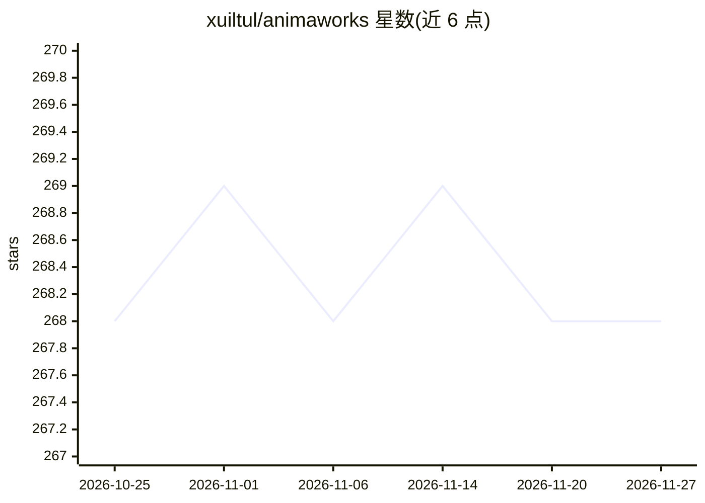

# xuiltul/animaworks

⭐ 268 · Python · Apache-2.0 · 推送 2026-11-26 · [GitHub](https://github.com/xuiltul/animaworks) · 组织维护 · 中文 README

**让 AI agent 组成 24/7 自主协作组织的框架**

AnimaWorks 是一个开源框架，将持久化 AI agent（Digital Animas）组织成持续运转的虚拟团队：每个 agent 具备长期记忆、身份、角色与日程。用户通过 LINE 风格聊天界面交互，底层 agent 在隔离 OS 进程中拆解目标、在 git worktree 沙盒并行写码、互相评审、开 PR 并自动修复 CI。提供脑启发式多层记忆（ChromaDB 向量 + BM25 + 事实记录，含睡眠期整合与主动遗忘）、SQLite 任务板、权限与 PII 隔离（Enclave）、Heartbeat/Cron 定时巡逻。安装支持一键脚本、Docker Compose 与 pip；原生 Windows 不支持，需经 WSL 运行。

## 筛选速览

| 维度 | 判定 | 备注 |
|---|---|---|
| AI 角色 | `ai-ecosystem` | LLM/agent 周边工具 |
| 许可风险 | `permissive` | Apache-2.0 |
| 部署形态 | `self-host` | docker 或自建部署 |
| 模型依赖 | local-ok | 支持本地模型 |
| 硬件要求 | — | 无带数字的原话,不猜 |
| 安装摩擦 | `low` | 无编译、无系统依赖或容器化 |
| 成熟度 | — | 结构信号不足 |

## 能力要点

- 6 通道自动记忆唤起与混合检索（ChromaDB 向量 + BM25 + 原子事实 + RRF 融合）
- 睡眠周期式记忆整合与主动遗忘机制
- LINE 风格聊天 UI，含审批卡片、文件附件、Slack 消息镜像与全屏语音通话
- Heartbeat/Cron 自主巡逻与 SQLite TaskStore 任务分解

## 适用场景

- 让多个 AI agent 组成团队全天候自主开发与维护软件
- 通过聊天界面指挥虚拟团队并一键审批 agent 的请求
- 给 agent 配置带长期记忆与日程的常驻角色（如助理、市场、翻译）

## 场景标签

`Agent 框架` `多智能体` `Agent 记忆` `编码 Agent` · 领域:Agent 开发

## 证据(README 行号)

> L5: AnimaWorks is an open-source framework that brings together persistent AI agents (**Digital Animas**) — each with th
> L17: AnimaWorks does not hardcode a rigid build pipeline. Instead, it provides **organizational infrastructure**: neuros
> L79: 2. **LLM Connection** (Claude Code subscription login, Codex login, API keys, or local Ollama)

## 星数曲线

2026-10-25 268 → 2026-11-27 268（+0）

---
*卡片 v1 · prompt 1.4 · 生成 2026-11-25 · 置信度 high · 依据 README sha `fcd9fd1f8710` · [字段定义](../../DATASET.md)*
