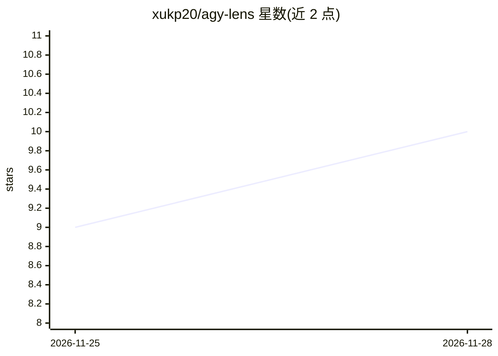

# xukp20/agy-lens

⭐ 10 · JavaScript · MIT · 推送 2026-11-27 · [GitHub](https://github.com/xukp20/agy-lens) · 个人维护 · 中文 README

**Antigravity Desktop/CLI 的本地只读遥测侧边栏：缓存与成本观测**

AGY Lens 是面向 Antigravity Desktop 与 CLI 的本地只读遥测侧边栏，以 readOnly 方式打开本地会话 SQLite 数据库，在纯 Node.js 24（node:sqlite，零 npm 依赖）中解析 Protobuf 数据。提供 8 个可独立开关的模块：实时上下文构成与 Auto-Compact 上限追踪、提示缓存命中诊断、跨会话缓存未命中观测矩阵、按模型的长上下文 API 等效成本分析、16 周日历热力图、两位小数的手动配额对齐与周期预算反推。基于宿主原生 sidecar_sdk 生命周期，面板隐藏时暂停轮询；界面支持中英双语切换。

## 筛选速览

| 维度 | 判定 | 备注 |
|---|---|---|
| AI 角色 | `ai-ecosystem` | LLM/agent 周边工具 |
| 许可风险 | `permissive` | MIT |
| 部署形态 | `library` | 以包/库形式分发 |
| 模型依赖 | — | README 未给出锁定关系 |
| 硬件要求 | — | 无带数字的原话,不猜 |
| 安装摩擦 | `low` | 无编译、无系统依赖或容器化 |
| 成熟度 | — | 结构信号不足 |

## 能力要点

- 严格本地只读：readOnly 打开会话 SQLite，零 npm 依赖
- 提示缓存诊断：命中率、节省 USD、15 轮堆叠柱图
- 跨会话缓存未命中观测矩阵与隐私脱敏 Markdown 导出
- 16 周日历热力图与手动两位小数配额对齐

## 适用场景

- 诊断 Antigravity 会话中提示缓存未命中的原因
- 按模型统计长上下文使用的 API 等效成本
- 手动对齐并追踪各池 7 天配额周期消耗

## 场景标签

`LLM 可观测性` · 领域:评测与运维

## 证据(README 行号)

> L5:  Local-first, strictly read-only telemetry sidecar for Antigravity Desktop &amp; CLI.
> L22: - **Strictly Local & Read-Only**: Opens Antigravity Desktop (`~/.gemini/antigravity/conversations/*.db`) and CLI (`
> L24: - **Visibility-Gated Zero Idle Overhead**: Built on Antigravity's native `sidecar_sdk` auxiliary pane lifecycle—aut

## 星数曲线

2026-11-25 9 → 2026-11-28 10（+1）

---
*卡片 v1 · prompt 1.4 · 生成 2026-11-25 · 置信度 low · 依据 README sha `733efe7ab5fb` · [字段定义](../../DATASET.md)*
