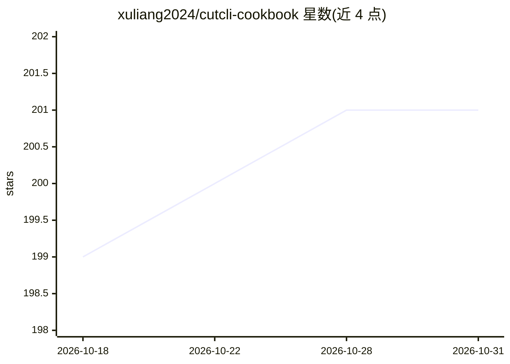

# xuliang2024/cutcli-cookbook

⭐ 201 · JavaScript · MIT · 推送 2026-05-26 · [GitHub](https://github.com/xuliang2024/cutcli-cookbook) · [官网](https://docs.cutcli.com) · 组织维护 · 中文 README

**cutcli 的官方食谱库：示例、JSON 模板与 AI 提示词，用于代码生成剪映草稿**

为 cutcli（把 shell 命令或 JSON 转成剪映/CapCut 可直接打开的桌面草稿文件夹的单二进制 CLI）配套的 cookbook 仓库：收录 5 个一键运行示例、可复用字幕/动画/滤镜 JSON 模板、面向 Cursor/Claude Code/ChatGPT/MCP agent 的系统提示词，以及 docs.cutcli.com 的 VitePress 文档源码与 Cloudflare Worker。cutcli v1.3.9 起支持上传本地草稿 zip 提交云端渲染，草稿格式同时兼容国际版 CapCut 与国内剪映。安装方式为 curl 脚本。

## 筛选速览

| 维度 | 判定 | 备注 |
|---|---|---|
| AI 角色 | `ai-knowledge` | 知识聚合/清单类 |
| 许可风险 | `permissive` | MIT |
| 部署形态 | `None` |  |
| 模型依赖 | — | README 未给出锁定关系 |
| 硬件要求 | — | 无带数字的原话,不猜 |
| 安装摩擦 | `medium` | 含编译或系统依赖之一 |
| 成熟度 | — | 结构信号不足 |

## 能力要点

- 5 个可运行示例（字幕、图片轮播+BGM、关键词高亮、音频自适应、关键帧缩放）
- 提供驱动 cutcli 的 Cursor / Claude Code / ChatGPT 系统提示词
- cutcli v1.3.9 起支持云端渲染（上传草稿 zip 提交渲染并查询结果）
- 草稿格式同时兼容 CapCut 国际版与剪映国内版

## 适用场景

- 用脚本或 AI agent 生成可在剪映/CapCut 中继续编辑的草稿
- 复制 JSON 模板快速加字幕、动画、转场和滤镜
- 定时把草稿提交云端渲染做自动化检查或预览

## 场景标签

`提示工程` `代码生成` · 领域:Agent 开发

## 证据(README 行号)

> L3: > Open-source cookbook, JSON templates, AI prompts, and docs for cutcli — the CapCut / Jianying (剪映) draft CLI. Gene
> L46: |Directory|Purpose|

## 星数曲线

2026-10-18 199 → 2026-10-31 201（+2）

---
*卡片 v1 · prompt 1.4 · 生成 2026-10-22 · 置信度 high · 依据 README sha `101ed304533e` · [字段定义](../../DATASET.md)*
