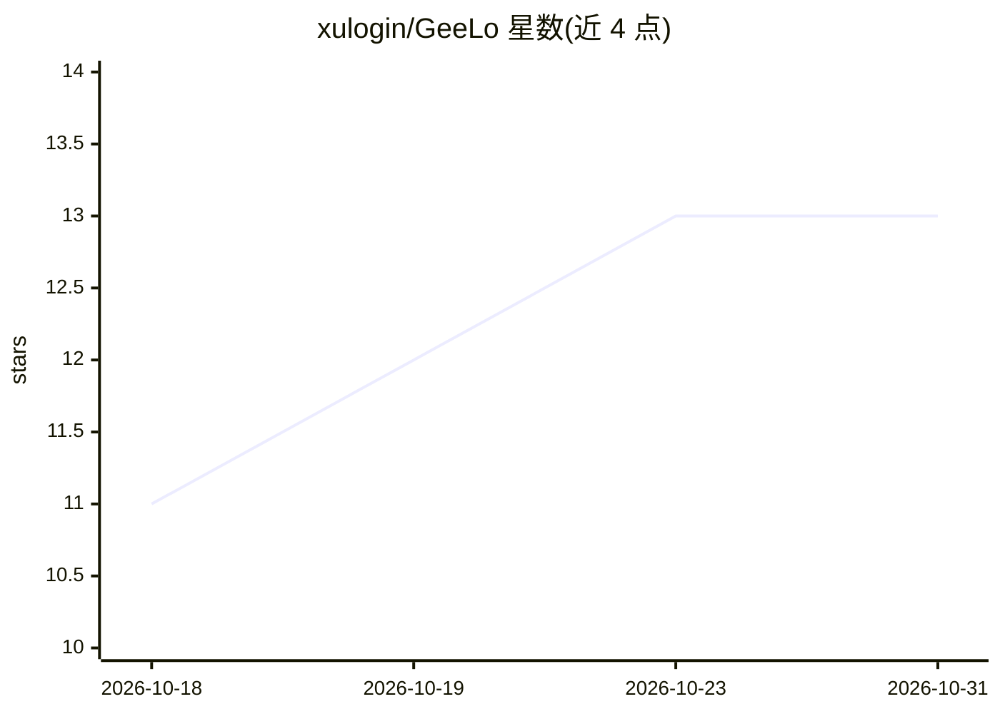

# xulogin/GeeLo

⭐ 13 · JavaScript · MIT · 推送 2026-09-22 · [GitHub](https://github.com/xulogin/GeeLo) · 个人维护 · 中文 README

**让 AI 编码工具自主运行并调通 GEE 脚本的 skill 工作流**

面向 Claude Code / Codex / Cursor / Gemini CLI 等 AI 工具的 skill（插件形态）：AI 写完 Google Earth Engine JavaScript 脚本后，在本机连真实 Earth Engine 服务器自行运行、读取服务端反馈、修改并复跑，调通且数值合理后才交付。可查出波段名写错、集合为空、内存超限、数值不合理等运行时问题。需 Windows、Node.js 20.19+、GEE 账号与已注册 Cloud 项目；Export 仅校验参数不真导出，脚本跑在 vm 沙箱，全程只读。

## 筛选速览

| 维度 | 判定 | 备注 |
|---|---|---|
| AI 角色 | `ai-ecosystem` | LLM/agent 周边工具 |
| 许可风险 | `permissive` | MIT |
| 部署形态 | `None` |  |
| 模型依赖 | — | README 未给出锁定关系 |
| 硬件要求 | — | 无带数字的原话,不猜 |
| 安装摩擦 | `low` | 无编译、无系统依赖或容器化 |
| 成熟度 | — | 结构信号不足 |

## 能力要点

- AI 写→自跑→看服务端反馈→自改→调通再交付的免干预循环
- 以插件/skill 形式接入 Claude Code、Codex 等，规矩写在通用 AGENTS.md 不绑定单一工具
- Export 只校验不真导出，脚本运行于 vm 沙箱且全程只读
- 首次用自动装依赖，认证走浏览器弹窗自动配置项目 ID

## 适用场景

- 我用 AI 写 GEE 脚本时不想手动复制粘贴到 Code Editor 调错
- 让 AI 在交付前自己验证遥感计算脚本在真实服务器上能跑通且数值合理
- 在 Claude Code 里用 /geelo 斜杠命令直接提遥感需求开工

## 场景标签

`编码 Agent` · 领域:编码与开发

## 证据(README 行号)

> L30: 本项目是一个**给 AI 用的 skill（工作流）**，它本身不写脚本，也不替你出图——
> L33: 所以它**必须配合 AI 使用**（Claude Code、Codex 等）。单独 clone 下来当软件用，

## 星数曲线

2026-10-18 11 → 2026-10-31 13（+2）

---
*卡片 v1 · prompt 1.4 · 生成 2026-10-31 · 置信度 high · 依据 README sha `ec00cb195601` · [字段定义](../../DATASET.md)*
