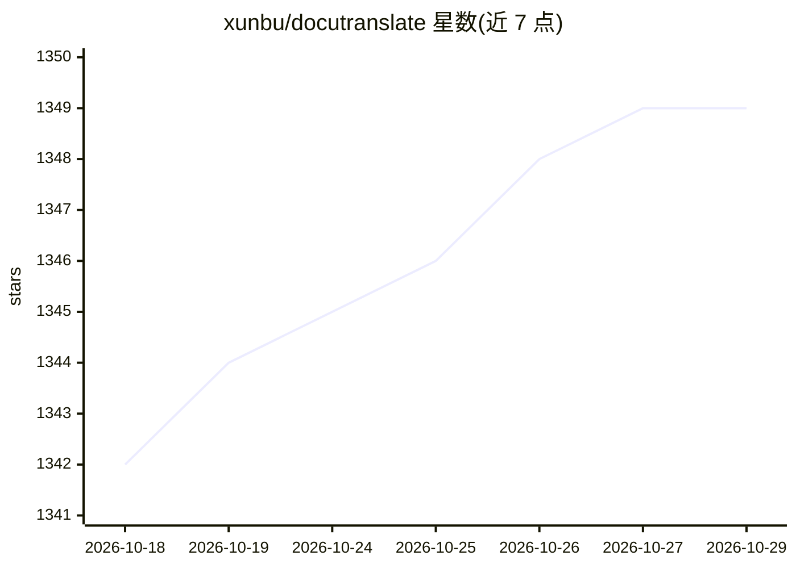

# xunbu/docutranslate

⭐ 1,349 · Python · MPL-2.0 · 推送 2026-10-12 · [GitHub](https://github.com/xunbu/docutranslate) · 个人维护 · 中文 README

**基于 LLM 的本地文档翻译工具：pdf/word/excel/字幕等格式**

面向需要翻译小说、论文、字幕等文档的用户：调用大模型 API 将 pdf/docx/xlsx/epub/srt/ass/json 等格式文件翻译为目标语言，保持原文档格式。PDF 经 mineru（在线或本地部署）解析，支持表格、公式、代码识别；可自动生成术语表保持译名一致，支持 JSONPath 指定 JSON 翻译范围。提供 Web UI、RESTful API、MCP 服务与 Python SDK，支持异步并发、局域网多用户。限制：PDF 翻译会丢失原始排版；不支持旧版 doc/xls。

## 筛选速览

| 维度 | 判定 | 备注 |
|---|---|---|
| AI 角色 | `ai-native` | 本体是模型或模型工具 |
| 许可风险 | `permissive` | MPL-2.0 |
| 部署形态 | `self-host` | docker 或自建部署 |
| 模型依赖 | — | README 未给出锁定关系 |
| 硬件要求 | — | 无带数字的原话,不猜 |
| 安装摩擦 | `low` | 无编译、无系统依赖或容器化 |
| 成熟度 | — | 结构信号不足 |

## 能力要点

- 支持 pdf/docx/xlsx/epub/srt/ass/json 等 10+ 种格式的 LLM 翻译
- mineru 引擎解析 PDF 表格、公式与代码（在线或本地部署）
- 自动术语表生成与自定义术语字典
- 提供 Web UI、RESTful API、MCP 服务与 Python Client SDK

## 适用场景

- 翻译外语论文并识别其中的表格与公式
- 翻译小说、字幕（srt/ass）文件并保留原格式
- 只翻译 JSON 配置中指定路径的文本
- 在局域网内多人同时使用文档翻译服务

## 场景标签

 · 领域:文档处理/翻译工具

## 证据(README 行号)

> L13:  A lightweight local file translation tool based on Large Language Models.
> L20: - ✅ **Multi-AI Platform Support**: Supports most AI platforms, allowing for high-performance concurrent AI translat

## 星数曲线

2026-10-18 1,342 → 2026-10-29 1,349（+7）

---
*卡片 v1 · prompt 1.4 · 生成 2026-10-21 · 置信度 high · 依据 README sha `04c18edd83a5` · [字段定义](../../DATASET.md)*
