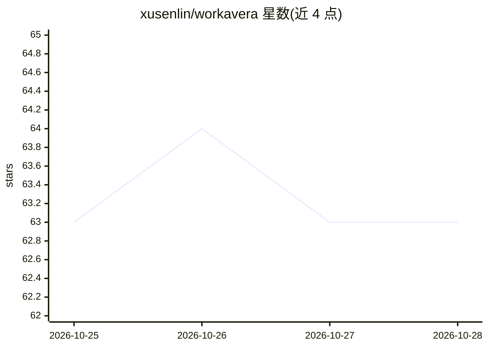

# xusenlin/workavera

⭐ 63 · TypeScript · Apache-2.0 · 推送 2026-09-04 · [GitHub](https://github.com/xusenlin/workavera) · [官网](https://workavera.com) · 个人维护 · 中文 README

**面向自由职业者与小团队的自托管 AI 协作工作区**

用 Go 编写的单体二进制应用，内嵌前端与 PocketBase/SQLite，将看板项目管理、文档、日历、阅读收藏、联系人与 AI 聊天整合到一台自有服务器上。核心机制是权限感知的工具调用：助手在账户已有权限内检索上下文、创建和更新记录，服务端对每次调用重新鉴权，AI 不使用特权账户。自带模型，通过 OpenAI/OpenAI 兼容/Anthropic/Google 四种协议接入托管或本地模型，工具另以 MCP 暴露给 Claude Code、Cursor 等客户端。自述为 0.x 早期阶段，可能有破坏性变更，未达到生产就绪。

## 筛选速览

| 维度 | 判定 | 备注 |
|---|---|---|
| AI 角色 | `ai-enhanced` | 去掉 AI 部分产品仍成立 |
| 许可风险 | `permissive` | Apache-2.0 |
| 部署形态 | `desktop` | 安装包/桌面程序 |
| 模型依赖 | local-ok | 支持本地模型 |
| 硬件要求 | — | 无带数字的原话,不猜 |
| 安装摩擦 | `low` | 无编译、无系统依赖或容器化 |
| 成熟度 | `idea` | |

## 能力要点

- 权限感知 AI 工具调用：服务端对每次调用按身份/角色/所有权/版本重新鉴权
- 单二进制部署，数据存于 PocketBase/SQLite，无需 Postgres/Redis/向量库
- 四种模型协议（OpenAI/OpenAI 兼容/Anthropic/Google）支持自带模型与本地推理（LM Studio/Ollama/vLLM/llama.cpp）
- 同一套工具经 MCP（/api/mcp）以作用域 API key 暴露给外部 AI 客户端

## 适用场景

- 小团队在自有服务器上统一管理项目、文档、日历与联系人
- 通过聊天让 AI 在自己权限内代为创建和更新工作区记录
- 订阅源 AI 摘要与链接收藏管理
- 让 Claude Code/Cursor 等既有 AI 工具直接操作自己的工作区

## 场景标签

`聊天机器人` `知识库管理` · 领域:对话与助手

## 证据(README 行号)

> L22: - **Permission-aware AI tool calling.** Chat can search your context and operate Board, Calendar, Docs, Reading, an
> L151: - **Board** manages Kanban projects with custom workflow states, labels, members and roles, due dates, task activi

## 星数曲线

2026-10-25 63 → 2026-10-28 63（+0）

---
*卡片 v1 · prompt 1.4 · 生成 2026-10-24 · 置信度 mid · 依据 README sha `ab19a383cc27` · [字段定义](../../DATASET.md)*
