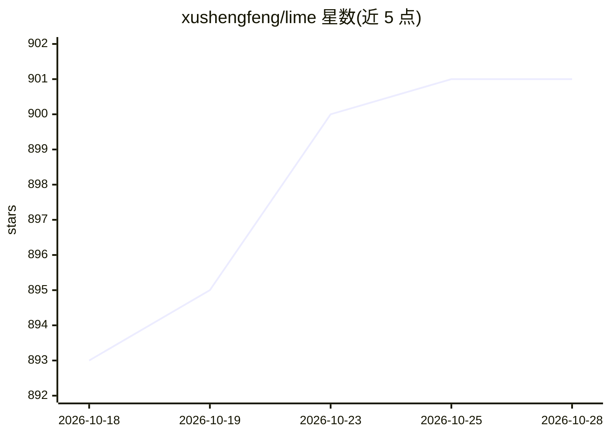

# xushengfeng/lime

⭐ 901 · TypeScript · GPL-3.0 · 推送 2026-06-30 · [GitHub](https://github.com/xushengfeng/lime) · 个人维护 · 中文 README

**LLM 驱动的拼音输入法引擎，以 Rime 为前端**

用 TypeScript/Deno 编写的输入法引擎：运行一个 AI 服务器，接收输入法前端发送的按键数据，用本地小模型 Qwen3-0.6B（GGUF 量化版）生成候选词，用户拼音参与采样选择。前端接入 Rime（作为独立 llm schema），支持 HiAE 加密认证，提供模糊音、多种双拼方案、Web 演示界面与打字统计。限制：长句输入可能不智能、输入过快可能漏字母、无生词记忆。

## 筛选速览

| 维度 | 判定 | 备注 |
|---|---|---|
| AI 角色 | `ai-native` | 本体是模型或模型工具 |
| 许可风险 | `viral` | GPL-3.0 |
| 部署形态 | `None` |  |
| 模型依赖 | local-ok | 支持本地模型 |
| 硬件要求 | — | 无带数字的原话,不猜 |
| 安装摩擦 | `low` | 无编译、无系统依赖或容器化 |
| 成熟度 | — | 结构信号不足 |

## 能力要点

- 本地 Qwen3-0.6B-IQ4_XS 生成候选，拼音辅助采样
- Rime 前端接入，HiAE 加密认证请求
- 支持模糊音与多种双拼方案（自然码/搜狗/微软/小鹤等）
- 可切换为 ollama 加载的模型

## 适用场景

- 在 Rime 中使用 LLM 生成候选词的拼音输入法
- 本地运行 AI 输入法服务器并通过网页演示试用
- 统计自己的打字速度与候选查找耗时

## 场景标签

 · 领域:输入法/NLP 应用

## 证据(README 行号)

> L3: llm 驱动的输入法。目前支持拼音。
> L5: llm 常用的文本生成方式是自回归，也就是预测下一个词（token）的所有可能，然后通过某种方式采样选择某个可能，追加到模型输入，然后再次预测。这个项目，把词可能的选择采样交给了用户拼音，利用用户拼音来辅助采样。
> L7: 使用小型大模型 Qwen3-0.6B-IQ4_XS ，兼顾速度和联想能力，打字时速度和普通引擎基本无异。

## 星数曲线

2026-10-18 893 → 2026-10-28 901（+8）

---
*卡片 v1 · prompt 1.4 · 生成 2026-10-21 · 置信度 high · 依据 README sha `61490c17d8b5` · [字段定义](../../DATASET.md)*
