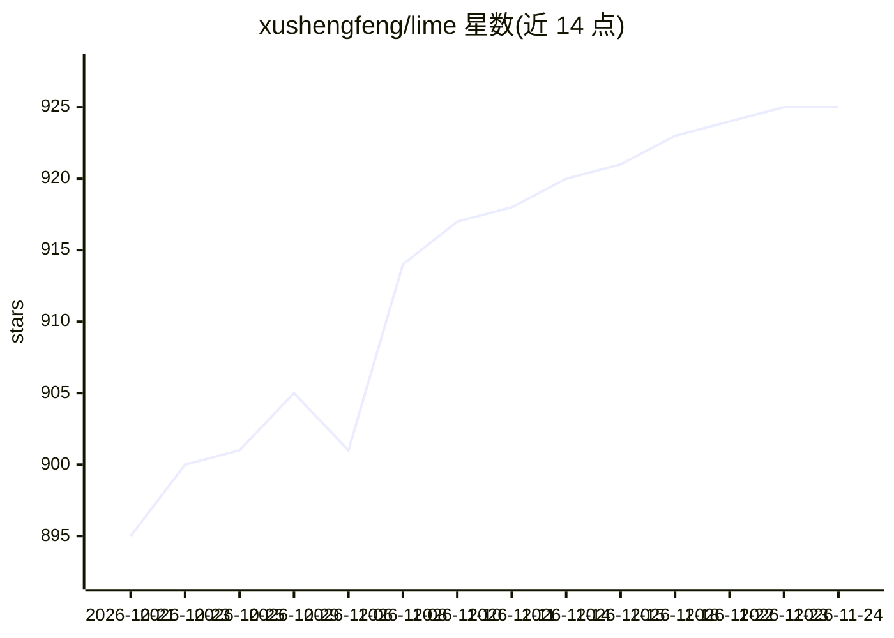

# xushengfeng/lime

⭐ 925 · TypeScript · GPL-3.0 · 推送 2026-10-31 · [GitHub](https://github.com/xushengfeng/lime) · 个人维护 · 中文 README

**大模型驱动的拼音输入法，用户拼音引导 token 采样**

用小型大模型 Qwen3-0.6B 作为拼音输入法引擎：把自回归采样的候选选择交给用户拼音引导，按拼音从模型下一步概率分布中筛选候选。架构为本地运行一个 HTTP 服务器（Hono，Node.js/pnpm），Rime 作为输入法前端通过 /candidates 和 /commit 接口交互，支持 HiAE 加密认证与密钥鉴权。内置两种候选算法（lime-v1、dict-llm-v1），支持模糊音、多种双拼方案，并提供防退化评测基准与输入统计。局限包括长句输入欠稳、无生词记录、重启丢失记忆。

## 筛选速览

| 维度 | 判定 | 备注 |
|---|---|---|
| AI 角色 | `ai-native` | 本体是模型或模型工具 |
| 许可风险 | `viral` | GPL-3.0 |
| 部署形态 | `library` | 以包/库形式分发 |
| 模型依赖 | local-ok | 支持本地模型 |
| 硬件要求 | — | 无带数字的原话,不猜 |
| 安装摩擦 | `low` | 无编译、无系统依赖或容器化 |
| 成熟度 | — | 结构信号不足 |

## 能力要点

- 拼音引导 LLM token 采样的输入法引擎，使用 Qwen3-0.6B-IQ4_XS
- Rime 前端 + 本地服务器架构，接口支持 HiAE 加密认证
- 内置 lime-v1 与 dict-llm-v1 两种候选算法，支持双拼与模糊音
- 提供防退化评测、消融对比与首选字符覆盖率基准

## 适用场景

- 在 Rime 中启用一个由本地小模型驱动的拼音输入法
- 本地运行 LLM 服务器并自定义候选算法与配置
- 对拼音输入法候选排序做基准评测与消融实验

## 场景标签

 · 领域:输入法/人机交互

## 证据(README 行号)

> L3: llm 驱动的输入法。目前支持拼音。
> L73: 这里使用rime作为前端。

## 星数曲线

2026-10-21 895 → 2026-11-24 925（+30）

---
*卡片 v1 · prompt 1.4 · 生成 2026-11-24 · 置信度 high · 依据 README sha `06e02e3e1163` · [字段定义](../../DATASET.md)*
