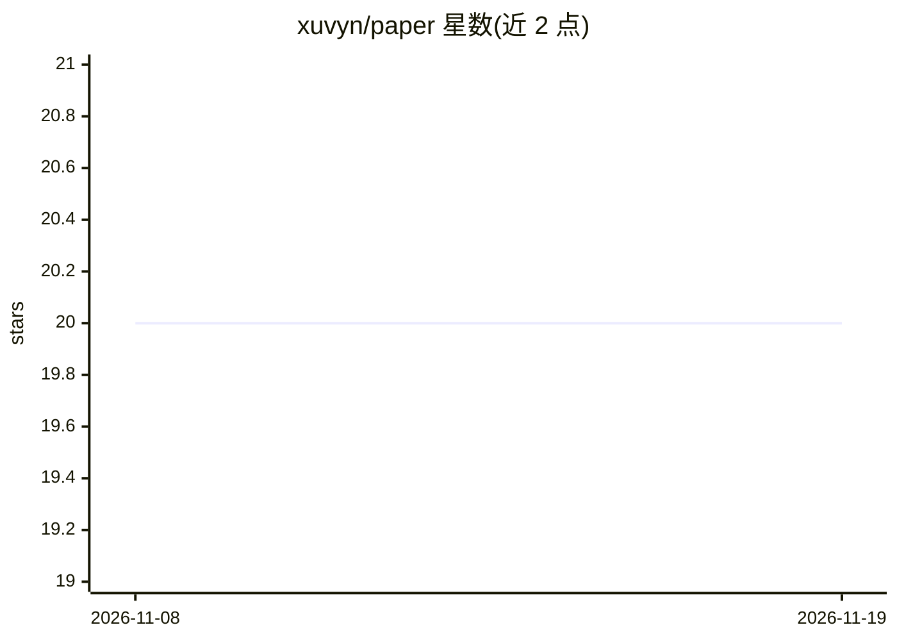

# xuvyn/paper

⭐ 20 · Shell · MIT · 推送 2026-11-05 · [GitHub](https://github.com/xuvyn/paper) · 个人维护 · 中文 README

**个人计算机科学学习清单：论文/书籍/课程/项目追踪**

作者的个人学习计划仓库，以表格形式列出计划研读的分布式系统与数据库论文（GFS、MapReduce、Spark、Spanner、Raft、Paxos 等）、书籍（算法导论、操作系统等）、基础算法条目与公开课程（15-440、6.824 等），以及两个实践项目，并用备注列标记完成进度。无安装或运行内容，属知识整理型清单。

## 筛选速览

| 维度 | 判定 | 备注 |
|---|---|---|
| AI 角色 | `ai-knowledge` | 知识聚合/清单类 |
| 许可风险 | `permissive` | MIT |
| 部署形态 | `None` |  |
| 模型依赖 | — | README 未给出锁定关系 |
| 硬件要求 | — | 无带数字的原话,不猜 |
| 安装摩擦 | `low` | 无编译、无系统依赖或容器化 |
| 成熟度 | — | 结构信号不足 |

## 能力要点

- GFS/MapReduce/Spark/Spanner 等论文清单及阅读进度标记
- 计算机书籍阅读清单
- 分布式系统课程列表（15-440、6.824 等）
- 基础数据结构算法条目列表

## 适用场景

- 查找分布式系统领域的经典论文阅读顺序
- 参考个人计算机基础的系统学习路径

## 场景标签

`精选清单` · 领域:学习与行业

## 证据(README 行号)

> L9: 我计划通过顶级的论文结合大量书籍，深入理解计算机科学技术。
> L13: |论文|分类|地址|总结|备注|

## 星数曲线

2026-11-08 20 → 2026-11-19 20（+0）

---
*卡片 v1 · prompt 1.4 · 生成 2026-11-18 · 置信度 high · 依据 README sha `1f7afb929f55` · [字段定义](../../DATASET.md)*
