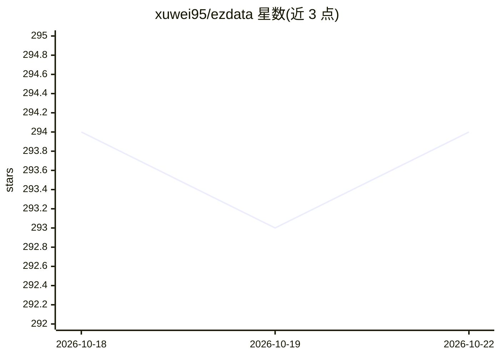

# xuwei95/ezdata

⭐ 294 · Python · MIT · 推送 2026-08-14 · [GitHub](https://github.com/xuwei95/ezdata) · [官网](http://www.ezdata.cloud) · 个人维护 · 中文 README

**AI 原生数据平台：数据集成调度 + 每源 RAG 知识库 + Agent 查询分析**

基于 RuoYi-Vue3-FastAPI 脚手架构建的数据平台：60+ 数据源连接器、dlt 驱动的 ETL、Celery/APScheduler 定时与 DAG 任务编排，支持 RBAC 与多租户。知识库模块（RAG）按数据源独立建库，文档解析分块后存入 ES8（稠密向量 + kNN + BM25 混合检索）。AI 模块统一管理模型密钥，提供 Agno Agent 对话查询、图表生成、Agent Skills、AI 应用封装与跨会话长期记忆；沙箱内执行查询与计算。快速启动走 Docker Compose，另附带 AKShare 财经演示数据集，并提供不依赖平台的轻量查询 UI。

## 筛选速览

| 维度 | 判定 | 备注 |
|---|---|---|
| AI 角色 | `ai-enhanced` | 去掉 AI 部分产品仍成立 |
| 许可风险 | `permissive` | MIT |
| 部署形态 | `None` |  |
| 模型依赖 | — | README 未给出锁定关系 |
| 硬件要求 | — | 无带数字的原话,不猜 |
| 安装摩擦 | `low` | 无编译、无系统依赖或容器化 |
| 成熟度 | — | 结构信号不足 |

## 能力要点

- 60+ 连接器 + dlt ETL + DAG 任务编排（AntV X6 画布）
- 每数据源独立 RAG 知识库，ES8 混合检索
- Agno Agent 在沙箱中查询数据并生成图表/结论
- 指标层 + 任务级血缘，Agent 优先按指标名取数

## 适用场景

- 统一接入异构数据源并做 ETL 与定时调度
- 为各数据源建 RAG 知识库并用对话查询分析数据
- 把提示词/工具/知识库打包成对外 API 的 AI 应用

## 场景标签

 · 领域:数据工程/数据分析平台

## 证据(README 行号)

> L14: > ezdata is an AI-native data platform: unify heterogeneous data sources, run ETL integration and task orchestratio
> L18: - **Data management** `module_data`: 60+ connectors (RDBMS / Elasticsearch / MongoDB / Kafka / vector stores / obje
> L21: - **AI** `module_ai` / `module_dashboard`: unified AI model management (keys AES-encrypted, **reasoning/thinking** 

## 星数曲线

2026-10-18 294 → 2026-10-22 294（+0）

---
*卡片 v1 · prompt 1.4 · 生成 2026-10-21 · 置信度 mid · 依据 README sha `d36f2b0a8311` · [字段定义](../../DATASET.md)*
