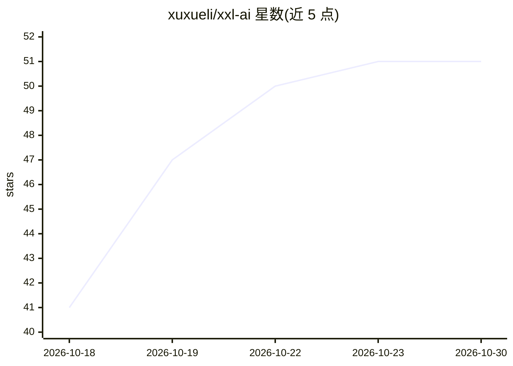

# xuxueli/xxl-ai

⭐ 51 · TypeScript · GPL-3.0 · 推送 2026-10-25 · [GitHub](https://github.com/xuxueli/xxl-ai) · [官网](http://www.xuxueli.com/xxl-ai/) · 个人维护 · 中文 README

**云本结合的 AI Agent 开发平台：云版编排发布 + 本地桌面工作台**

XXL-AI 是一个 AI Agent 开发平台，提供两种交付形态：云版为 B/S Web 应用，以 Agent 编排为中枢，标准化扩展 MCP + SKILL + RAG，配套多模型供应商接入（OpenAI 兼容协议）、多业务空间（Tenant）隔离、RBAC 权限、SSE 流式对话与 Docker Compose 一键部署（依赖 MySQL + Redis + Milvus），面向团队；本地版为 Electron + Vue3 桌面客户端，项目目录绑定工作区，提供 Plan/Build 双模式、终端/文件/浏览器面板，数据仅落本地 SQLite，零外部依赖，面向个人。GPL v3 开源。

## 筛选速览

| 维度 | 判定 | 备注 |
|---|---|---|
| AI 角色 | `ai-ecosystem` | LLM/agent 周边工具 |
| 许可风险 | `viral` | GPL-3.0 |
| 部署形态 | `self-host` | docker 或自建部署 |
| 模型依赖 | local-ok | 支持本地模型 |
| 硬件要求 | — | 无带数字的原话,不猜 |
| 安装摩擦 | `low` | 无编译、无系统依赖或容器化 |
| 成熟度 | — | 结构信号不足 |

## 能力要点

- 云版：Agent 编排（模型+指令+知识库+MCP+SKILL 组合）与 UUID 一键发布
- RAG 知识库（Milvus 向量化检索）与远程/本地 MCP 工具接入
- 本地版桌面客户端：Plan/Build 双模式、项目目录沙箱、终端/文件/浏览器面板
- 本地版零依赖（仅本地 SQLite），离线可用；云版支持集群部署

## 适用场景

- 团队搭建多用户 Agent 平台并公开发布 Agent
- 个人在本机项目目录上用桌面 Agent 工作台执行编码与文件任务
- 统一接入 Deepseek、智谱 GLM、Ollama 等多模型供应商构建知识库问答

## 场景标签

`Agent 框架` `RAG` · 领域:Agent 开发

## 证据(README 行号)

> L25: XXL-AI is an AI Agent development platform delivered in two forms — **Cloud** (web / server) and **Desk** (desktop 
> L53: - 1、Agent 编排：模型 + 系统指令 + 知识库 + MCP + SKILL 组合为 Agent，各类资源均支持多选绑定；
> L101: - 10、多供应商模型：兼容 OpenAI 协议（OpenCodeGo / Ollama / Deepseek / 智谱GLM 等），支持 `{session}` 请求头占位，首次启动预置四个供应商；

## 星数曲线

2026-10-18 41 → 2026-10-30 51（+10）

---
*卡片 v1 · prompt 1.4 · 生成 2026-10-24 · 置信度 high · 依据 README sha `7ca2a542174d` · [字段定义](../../DATASET.md)*
