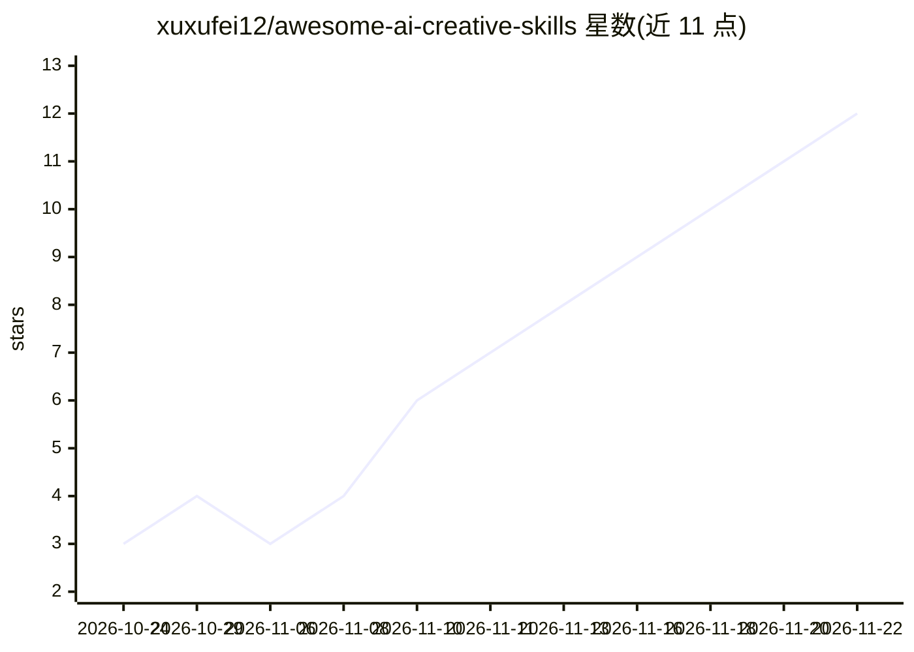

# xuxufei12/awesome-ai-creative-skills

⭐ 12 · Python · NOASSERTION · 推送 2026-11-18 · [GitHub](https://github.com/xuxufei12/awesome-ai-creative-skills) · 个人维护 · 中文 README

**AI 创意生成技能与提示词的双语策展清单（2,109 条预览）**

面向用 AI 制作图像、视频、动态图形与 3D 场景的创作者，按使用场景组织 12 个板块的收录条目：歌曲转 MV、知识科普动画、代码生成短片、创意图像与设计、艺术风格动画、3D 世界、广告片与叙事短片等。每条附内联 GIF 预览及对应的 Skill 或 Prompt 来源链接（指向收录条目的 GitHub 仓库），README 以英文与简体中文双语呈现，收录总数 2,109 条视觉预览。

## 筛选速览

| 维度 | 判定 | 备注 |
|---|---|---|
| AI 角色 | `ai-knowledge` | 知识聚合/清单类 |
| 许可风险 | `none` | NOASSERTION |
| 部署形态 | `None` |  |
| 模型依赖 | — | README 未给出锁定关系 |
| 硬件要求 | — | 无带数字的原话,不猜 |
| 安装摩擦 | `low` | 无编译、无系统依赖或容器化 |
| 成熟度 | — | 结构信号不足 |

## 能力要点

- 2,109 条内联 GIF 视觉预览，按 12 个创作场景分类
- 每条附 Skill / Prompt / How to make it 来源链接
- 英文·简体中文双语 README
- 覆盖图像生成、视频、动态图形与 3D 四类媒介

## 适用场景

- 为 Claude 类 agent 找视频/图像生成的现成 Skill
- 按效果找提示词复刻某种创意风格
- 为 AI 音乐 MV 或知识动画找制作方法参考

## 场景标签

`精选清单` `提示工程` · 领域:Agent 开发

## 证据(README 行号)

> L1: awesome-ai-creative-skills — Curated skills & prompts for AI image and video generation
> L8: > Skills, prompts, tools and examples that turn ideas into videos, images, motion graphics and 3D worlds.
> L12: Explore ways to create imaginative images, videos, motion graphics and 3D scenes with AI. This collection brings to

## 星数曲线

2026-10-24 3 → 2026-11-22 12（+9）

---
*卡片 v1 · prompt 1.4 · 生成 2026-11-19 · 置信度 high · 依据 README sha `4f045d81d215` · [字段定义](../../DATASET.md)*
