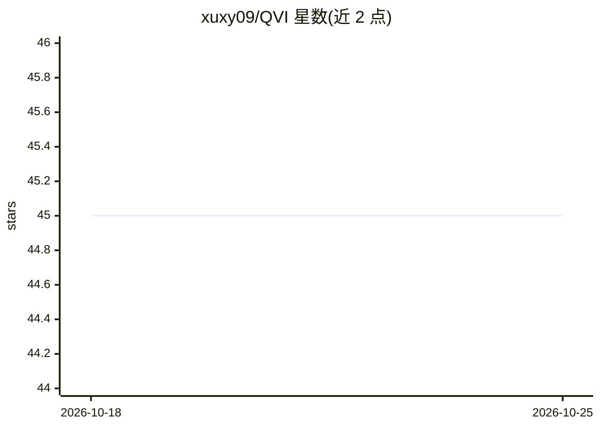

# xuxy09/QVI

⭐ 45 · Python · 推送 2026-07-29 · [GitHub](https://github.com/xuxy09/QVI) · 个人维护

**NeurIPS 2019 论文 QVI 的二次视频插帧官方实现**

论文 "Quadratic video interpolation"（NeurIPS 2019）的 PyTorch 官方实现，面向视频插帧（中间帧生成）研究者。提供预训练模型与 demo 脚本（demo.py），支持在 QVI-960 数据集上训练、在 Adobe-240/GoPro/UCF/Davis 等数据集上评测，并提供 Sequence.py 加载测试数据。依赖 Python 3.8、PyTorch 1.5.1、cudatoolkit 10.1、cupy 等指定版本，运行需自行下载预训练模型与 PWC-Net 权重。

## 筛选速览

| 维度 | 判定 | 备注 |
|---|---|---|
| AI 角色 | `ai-native` | 本体是模型或模型工具 |
| 许可风险 | `none` | — |
| 部署形态 | `None` |  |
| 模型依赖 | — | README 未给出锁定关系 |
| 硬件要求 | — | 无带数字的原话,不猜 |
| 安装摩擦 | `low` | 无编译、无系统依赖或容器化 |
| 成熟度 | — | 结构信号不足 |

## 能力要点

- 提供预训练模型 demo，可对图像序列做插帧
- 支持 QVI-960 数据集训练与多数据集评测
- 提供 Sequence.py 便捷加载 Adobe-240/GoPro/UCF/Davis 测试集

## 适用场景

- 复现 QVI 论文的视频插帧结果
- 在自有序列上生成中间帧
- 基于 QVI-960 训练或微调插帧模型

## 场景标签

`图像视频处理` · 领域:感知与多模态

## 证据(README 行号)

> L3: Implementation of "Quadratic video interpolation", NeurIPS 2019.
> L34: python demo.py configs/test_config.py

## 星数曲线

2026-10-18 45 → 2026-10-25 45（+0）

---
*卡片 v1 · prompt 1.4 · 生成 2026-10-25 · 置信度 high · 依据 README sha `9d73ae26f514` · [字段定义](../../DATASET.md)*
