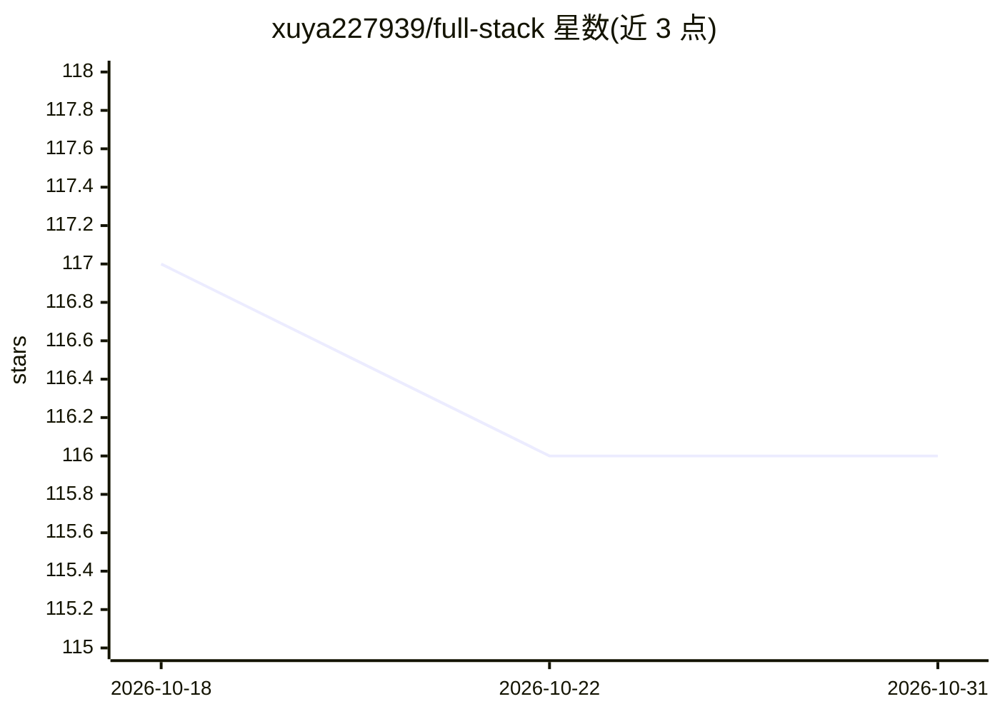

# xuya227939/full-stack

⭐ 116 · TypeScript · 推送 2026-08-22 · [GitHub](https://github.com/xuya227939/full-stack) · 个人维护 · 中文 README

**Next.js 16 全栈项目模板：认证、支付、存储、邮件一体化**

基于 Next.js 16 + React 19 的全栈起步模板，内置 Auth 认证、Supabase 集成、Stripe/Alipay 支付流程、Resend 邮件发送、R2 存储与 Redis 支持，另含 SEO 优化、博客、i18n 多语言与清理脚本。面向需要快速搭建生产级 Web 应用的开发者，用 Bun 管理依赖并分层加载 .env 环境变量。README 声明该模板支撑 SnapVee、SkillHub、Meshivo 3D 等站点，其中多个为 AI 相关产品，但模板本体不含 AI 功能。

## 筛选速览

| 维度 | 判定 | 备注 |
|---|---|---|
| AI 角色 | `ai-enhanced` | 去掉 AI 部分产品仍成立 |
| 许可风险 | `none` | — |
| 部署形态 | `None` |  |
| 模型依赖 | — | README 未给出锁定关系 |
| 硬件要求 | — | 无带数字的原话,不猜 |
| 安装摩擦 | `low` | 无编译、无系统依赖或容器化 |
| 成熟度 | `idea` | |

## 能力要点

- Auth 与 Supabase 集成
- Stripe / Alipay 支付流程
- Resend 邮件、R2 存储、Redis 支持
- 分层 .env 加载顺序（local/development/test/production）

## 适用场景

- 快速启动一个带认证和支付的全栈 SaaS 项目
- 搭建需要 Supabase 数据库与 R2 存储的 Web 应用
- 国内外双通道支付（Stripe/Alipay）的网站开发

## 场景标签

 · 领域:Web 开发/全栈模板

## 证据(README 行号)

> L5: A full-stack project based on Next.js 16 + React 19, including:
> L19: **SnapVee** — Universal Social Media Content AI Parser. Extract, download, and transform content from YouTube, TikT
> L23: **SkillHub** — Claude Skills & GPT Skills Marketplace. Discover curated premium skills to supercharge your workflow

## 星数曲线

2026-10-18 117 → 2026-10-31 116（-1）

---
*卡片 v1 · prompt 1.4 · 生成 2026-10-23 · 置信度 mid · 依据 README sha `3ca89300ea1c` · [字段定义](../../DATASET.md)*
